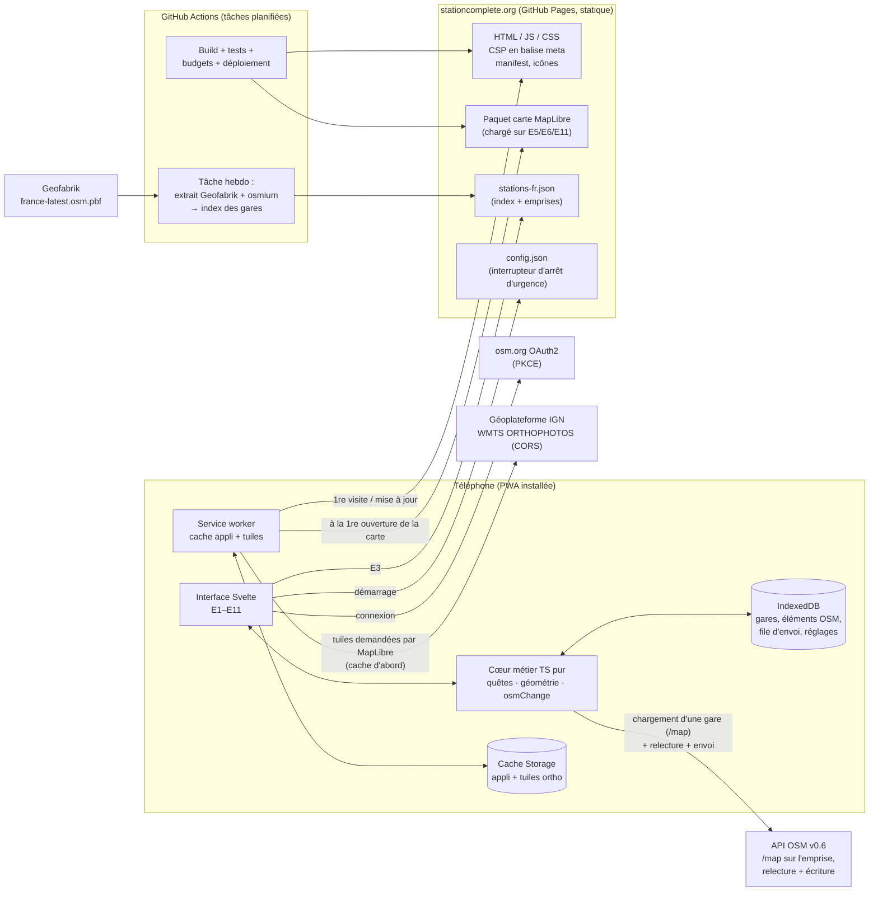
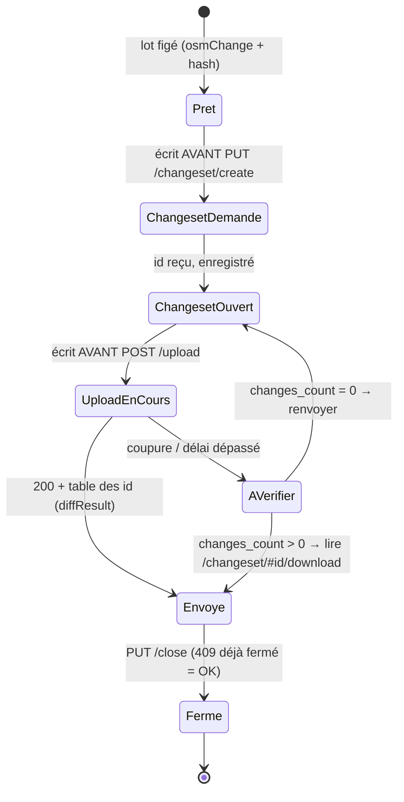

# stationcomplete — Dossier d'architecture du MVP

_Version 1.1, 5 novembre 2026 : révisée après les décisions de Loïc (ci-dessous). Rédigée à partir de la spécification UX v0.3 (`ux-spec.md`) et du rapport de modèle de données (`osm-tags-rapport.md`)._

## Décisions de Loïc (5 novembre 2026)

| #   | Sujet                 | Choix retenu                                                                                     | Principales conséquences dans ce dossier                                                                                                          |
| --- | --------------------- | ------------------------------------------------------------------------------------------------ | ------------------------------------------------------------------------------------------------------------------------------------------------- |
| D1  | Forge et hébergement  | **GitHub** : dépôt, GitHub Actions et **GitHub Pages** pour stationcomplete.org                  | Pas d'en-têtes HTTP personnalisés : CSP en balise `<meta>` (§ 8.1) ; DNS GitHub (§ 7.2) ; cache HTTP fixe, compensé par le service worker (§ 7.1) |
| D2  | Bibliothèque de carte | **MapLibre GL JS** (6.16)                                                                        | Budget carte revu (§ 1.2), réglages d'économie d'énergie, couche IGN et module `MapView` (§ 3.2), CORS indispensable (§ 6.1)                      |
| D3  | Licence du code       | **GPL-3.0-or-later**                                                                             | § 10.2                                                                                                                                            |
| D4  | Lecture des données   | **API OSM seule** (`/map` sur l'emprise de la gare), **sans Overpass**, ni dans l'appli ni en CI | Chargement réécrit (§ 4.2) ; index des gares tiré de l'extrait Geofabrik avec osmium (§ 4.1) ; R7 revu                                            |
| D5  | Mesure d'audience     | **Aucune.** On compte seulement les changesets `created_by=stationcomplete`, qui sont publics    | Principe « aucun serveur stationcomplete » maintenu (§ 7.6)                                                                                       |

> **Comment lire ce document.** Chaque section se termine par ce qu'il faut retenir. Les faits techniques vérifiables ont une source (URL). Si une information n'a pas pu être vérifiée, la mention **[non vérifié]** l'indique, avec la façon de la vérifier.
>
> **Méthode de vérification.** Les pages web ont été consultées le 5 novembre 2026. Les **poids des bibliothèques** ont été **mesurés** ce jour-là : installation npm de la dernière version, puis `esbuild --bundle --minify` et `gzip -9`. Les accès directs à `data.geopf.fr`, `proxy-ign.openstreetmap.fr`, Overpass et `api.openstreetmap.org` étaient bloqués par le proxy de l'environnement de rédaction : ces services n'ont donc **pas été testés en direct**. Le lot 0 prévoit ces tests.

---

## Sommaire

1. Principes et contraintes
2. Vue d'ensemble
3. Choix techniques comparés
4. Données (index des gares, chargement, quêtes, géométrie, envoi)
5. Authentification OSM
6. Imagerie IGN
7. Hébergement et exploitation
8. Sécurité et garde-fous
9. Accessibilité et traduction
10. Structure du dépôt et licences
11. Plan de développement en lots
12. Risques, points ouverts et décisions
13. Pays (organisation par pays, lot P1)

---

## 1. Principes et contraintes

### 1.1 Les six principes

| #   | Principe                         | Conséquence concrète                                                                                                                                                                                                                                                                     |
| --- | -------------------------------- | ---------------------------------------------------------------------------------------------------------------------------------------------------------------------------------------------------------------------------------------------------------------------------------------- |
| P1  | **Le moins de serveur possible** | Site 100 % statique. Le navigateur parle directement à l'API OSM et à l'IGN. Aucune base de données ni compte stationcomplete, et aucune donnée personnelle côté serveur.                                                                                                                |
| P2  | **Local d'abord**                | Toute saisie est d'abord écrite dans le téléphone (IndexedDB), puis envoyée. Le réseau sert à se synchroniser, pas à fonctionner.                                                                                                                                                        |
| P3  | **Sobriété mesurée**             | Budgets chiffrés (§ 1.2), contrôlés automatiquement par la CI. Une PR qui dépasse un budget est refusée.                                                                                                                                                                                 |
| P4  | **Une gare à la fois**           | On ne charge jamais plus qu'une emprise d'environ 800 m. Pas de carte de France.                                                                                                                                                                                                         |
| P5  | **Humain dans la boucle**        | Chaque modification résulte d'une action explicite à l'écran. Il n'y a aucune modification de masse, donc le Code de conduite des modifications automatisées ne s'applique pas ([Automated Edits code of conduct](https://wiki.openstreetmap.org/wiki/Automated_Edits_code_of_conduct)). |
| P6  | **Portable vers le natif**       | La logique métier (quêtes, géométrie, osmChange) est en TypeScript pur, sans dépendance à l'interface. Une app native via Capacitor réutilise tout (§ 3.7).                                                                                                                              |

### 1.2 Budgets de sobriété (contrôlés en CI)

| Ressource                                                            | Budget                                                                           | Justification                                                                                                                                                                                                                                                                                                                                                                                                                                                        |
| -------------------------------------------------------------------- | -------------------------------------------------------------------------------- | -------------------------------------------------------------------------------------------------------------------------------------------------------------------------------------------------------------------------------------------------------------------------------------------------------------------------------------------------------------------------------------------------------------------------------------------------------------------- |
| JS initial (E1 à E4, compressé gzip)                                 | **≤ 90 ko**                                                                      | Runtime Svelte ≈ 17 ko (mesuré), osm-auth 2,3 ko, idb 1,4 ko, le reste pour le code applicatif                                                                                                                                                                                                                                                                                                                                                                       |
| JS carte, chargé **uniquement** sur E5, E6 et E11 (import dynamique) | **≤ 320 ko** (fil principal) **+ ≤ 150 ko** (worker)                             | MapLibre 6.16 mesuré : `maplibre-gl.mjs` 294 ko et `maplibre-gl-worker.mjs` 147 ko gzip, plus le code carte. Téléchargé **une fois par version**, puis servi par le service worker                                                                                                                                                                                                                                                                                   |
| CSS total (gzip)                                                     | **≤ 20 ko**                                                                      | Dont la CSS de MapLibre, 10 ko mesurés                                                                                                                                                                                                                                                                                                                                                                                                                               |
| Polices                                                              | **≤ 35 ko**                                                                      | Atkinson Hyperlegible en woff2, sous-ensemble latin, poids 400 (17,2 ko) et 700 (17,5 ko), mesurés sur `@fontsource/atkinson-hyperlegible` 5.3.0                                                                                                                                                                                                                                                                                                                     |
| Icônes                                                               | 1 sprite SVG en ligne, ≤ 8 ko                                                    | Pas de police d'icônes                                                                                                                                                                                                                                                                                                                                                                                                                                               |
| Index des gares                                                      | **≤ 180 ko** gzip                                                                | Chargé uniquement sur E3, puis gardé en cache. Il contient aussi l'emprise précalculée de chaque gare (§ 4.1)                                                                                                                                                                                                                                                                                                                                                        |
| Requêtes à la première visite (hors tuiles)                          | **≤ 12**                                                                         | HTML, JS, CSS, police, manifeste, icône, index                                                                                                                                                                                                                                                                                                                                                                                                                       |
| Requêtes aux visites suivantes                                       | **0** pour l'application                                                         | Tout est servi par le service worker. Une seule vérification de mise à jour, légère, à l'ouverture                                                                                                                                                                                                                                                                                                                                                                   |
| Chargement d'une gare                                                | **1 requête `/map`** (jusqu'à 4 pour une très grande gare) + les tuiles visibles | Pas de requête répétée : la gare filtrée est mise en cache (§ 4.2)                                                                                                                                                                                                                                                                                                                                                                                                   |
| Rendu de la carte                                                    | **À la demande**, jamais en continu                                              | MapLibre ne redessine que si quelque chose change (`map.repaint` est à `false` par défaut, d.ts 6.16). Autres réglages : `pixelRatio: Math.min(devicePixelRatio, 2)`, `fadeDuration: 0`, `raster-fade-duration: 0`, rotation et inclinaison désactivées, déplacements sans animation (`jumpTo`, `panBy` avec `duration: 0`), `setMaxParallelImageRequests(4)` (16 par défaut). Il n'y a pas d'option `maxFrameRate` dans MapLibre 6.16 (absente du fichier de types) |
| GPS                                                                  | **Ponctuel** (`getCurrentPosition`), délai max 20 s                              | Jamais `watchPosition`. Aucun suivi continu (spécification UX § 6)                                                                                                                                                                                                                                                                                                                                                                                                   |
| Animations                                                           | Aucune animation décorative, transitions ≤ 150 ms                                | `prefers-reduced-motion` respecté                                                                                                                                                                                                                                                                                                                                                                                                                                    |
| Thème                                                                | Sombre par défaut si le système est sombre                                       | Économie d'énergie sur les écrans OLED (spécification UX § 5.1)                                                                                                                                                                                                                                                                                                                                                                                                      |
| Interrogation périodique                                             | **Aucune**                                                                       | Le retour du réseau est détecté par l'événement `online` et à la remise au premier plan de l'appli                                                                                                                                                                                                                                                                                                                                                                   |

Les budgets sont contrôlés à chaque PR par un petit script (`scripts/check-budgets.mjs`), qui mesure les fichiers produits par le build et échoue au-delà des seuils. Pour mesurer en plus l'empreinte des pages, on peut utiliser EcoIndex, outil français libre ([ecoindex.fr](https://www.ecoindex.fr) **[non vérifié]**). Le Référentiel général d'écoconception de services numériques (RGESN) de l'État sert de grille de relecture **[non vérifié : version en vigueur]**.

> **À retenir.** Un site statique, des données dans le téléphone, des budgets chiffrés et vérifiés par la machine.

---

## 2. Vue d'ensemble

### 2.1 Schéma des composants



### 2.2 Rôle de chaque composant, et pourquoi il n'y a pas de serveur applicatif

| Composant        | Rôle                                                                                                            | Serveur stationcomplete ?                                                                                          |
| ---------------- | --------------------------------------------------------------------------------------------------------------- | ------------------------------------------------------------------------------------------------------------------ |
| Interface Svelte | Les 11 écrans                                                                                                   | Non : fichiers statiques                                                                                           |
| Cœur métier      | Calcul des quêtes, géométrie, construction de l'osmChange                                                       | Non : s'exécute dans le téléphone                                                                                  |
| Service worker   | Hors-ligne de l'appli et cache des tuiles                                                                       | Non : dans le navigateur                                                                                           |
| IndexedDB        | Données des gares, file d'envoi, pseudo OSM, réglages (le jeton OAuth reste dans le stockage d'osm-auth, § 5.3) | Non : dans le navigateur                                                                                           |
| Index des gares  | Recherche sur E3 et emprise de chaque gare                                                                      | **Fichier généré** une fois par semaine par GitHub Actions à partir de l'extrait Geofabrik, puis servi en statique |
| `config.json`    | Désactive les envois à distance en cas de bug grave, impose une version minimale                                | Fichier statique modifié à la main                                                                                 |
| API OSM          | Lecture d'une gare (`/map`), versions exactes avant envoi, changesets, notes                                    | Service officiel OSM                                                                                               |
| IGN              | Ortho 20 cm                                                                                                     | Service officiel de l'État                                                                                         |

**Aucun composant serveur n'est nécessaire au MVP.** Deux cas pourraient en justifier un plus tard, et aucun ne relève du MVP :

- un **proxy de tuiles** si l'IGN imposait une clé secrète. Aujourd'hui, le WMTS est ouvert sans clé (§ 6) ;
- un **calcul national de complétude** (jauges de toutes les gares sur E3), à faire en tâche CI, donc sans serveur non plus (§ 4.1.4).

> **À retenir.** Un hébergement statique (GitHub Pages) et une tâche planifiée suffisent. Les seuls serveurs utilisés par l'appli sont ceux d'OSM et de l'IGN ; la CI lit en plus l'extrait Geofabrik.

---

## 3. Choix techniques comparés

### 3.1 Framework d'interface

| Critère                           | **SvelteKit 3 + Svelte 5** (statique)                                                                                        | Preact 11 + Vite                                        | Lit 3 / vanilla + Vite                                                            |
| --------------------------------- | ---------------------------------------------------------------------------------------------------------------------------- | ------------------------------------------------------- | --------------------------------------------------------------------------------- |
| Runtime mesuré (gzip)             | ≈ 17 ko (composant minimal + `mount`)                                                                                        | ≈ 5,6 ko (`h`, `render`, hooks)                         | Lit ≈ 6 ko ; vanilla 0                                                            |
| Simplicité pour débutant          | **Très bonne** : fichiers `.svelte` proches du HTML, peu de concepts                                                         | Moyenne : JSX et hooks, pièges des dépendances d'effets | Lit : Web Components et décorateurs ; vanilla : tout à construire (routage, état) |
| Accessibilité                     | **Avertissements a11y à la compilation** ([Svelte — accessibility warnings](https://svelte.dev/docs/accessibility-warnings)) | Via ESLint (jsx-a11y)                                   | Rien d'intégré                                                                    |
| Routage, service worker, prérendu | **Intégrés** (`adapter-static`, `src/service-worker`)                                                                        | À assembler (router, vite-plugin-pwa)                   | À assembler                                                                       |
| Pérennité                         | Svelte 5 publié le 19/10/2024. **SvelteKit 3.0 publié le 01/10/2026** : très récent, 3.1.1 le 29/10/2026 (dates npm)         | Preact existe depuis 2015, 11.1.1 en 10/2026            | Lit est soutenu par Google ; vanilla ne se démode pas                             |
| Versions npm au 05/11/2026        | svelte 5.57.3, @sveltejs/kit 3.1.1, adapter-static 4.0.1                                                                     | preact 11.1.1, vite 8.3.6                               | lit 3.3.3                                                                         |

**Recommandation : SvelteKit 3 en mode statique (`adapter-static`, SPA avec prérendu des pages fixes).** C'est le meilleur compromis entre poids (le compilateur ne garde que ce qui sert) et simplicité pour un débutant. Les contrôles d'accessibilité sont intégrés, et le routage comme le service worker sont fournis. Le surcoût d'environ 11 ko par rapport à Preact est absorbé par le budget.
_Réserve :_ SvelteKit 3 n'a que cinq semaines. Si le lot 0 révèle un blocage, la branche 2.x reste maintenue (`@sveltejs/kit@version-2` = 2.70.4 sur npm). Le code applicatif ne change presque pas entre les deux.
_Changements de SvelteKit 3 à connaître (relecture du 05/11/2026, lus dans le paquet npm 3.1.1) :_ la configuration se fait **dans `vite.config.ts`** via `sveltekit({ … })` ; le fichier `svelte.config.js` « is no longer supported » (commentaire de `src/exports/vite/index.js`). Dépendances de pair : `svelte ^5.57.1`, `vite ^8.0.12`, `typescript ^6.0.0`. Moteur : **Node ≥ 22.17**.

### 3.2 Bibliothèque cartographique

| Critère                    | Leaflet 1.9.4                                                                                        | **MapLibre GL JS 6.16 (retenu, D2)**                          | OpenLayers 10.11                                      |
| -------------------------- | ---------------------------------------------------------------------------------------------------- | ------------------------------------------------------------- | ----------------------------------------------------- |
| Poids mesuré (gzip)        | **43 ko** + CSS 3,5 ko                                                                               | **≈ 290 ko** (build ESM : 294 ko + worker 147 ko) + CSS 10 ko | ≈ 108 ko pour Map, WMTS, Vector, Draw, Snap et Modify |
| Rendu                      | DOM + transformations CSS, SVG ou Canvas pour les tracés                                             | WebGL                                                         | Canvas 2D                                             |
| Coût GPU et mémoire        | Faible                                                                                               | Plus élevé (contexte WebGL) **[non mesuré]**                  | Moyen                                                 |
| Ortho raster (WMTS en XYZ) | Natif (`L.tileLayer`), sur-zoom via `maxNativeZoom`                                                  | Natif (source raster)                                         | **WMTS natif**                                        |
| Édition de géométries      | Plugins (Geoman 2.20.6) ou code maison                                                               | Plugins tiers (terra-draw…)                                   | **Draw, Modify, Snap intégrés**                       |
| Accrochage                 | Code maison                                                                                          | Code maison                                                   | Intégré (Snap)                                        |
| Simplicité                 | **Très simple**, très documenté                                                                      | Moyenne (styles JSON)                                         | Plus verbeux                                          |
| Pérennité                  | 1.9.4 date de mai 2023, 2.0.0-beta.1 du 02/11/2026. Base du site openstreetmap.org **[non vérifié]** | Très active ; MapLibre Native existe pour iOS et Android      | Très active, OSGeo                                    |

**Décidé le 5 novembre 2026 (D2) : MapLibre GL JS 6.16** (licence BSD-3-Clause, `package.json`, compatible GPL).

**Pourquoi ce choix :**

- **Moderne et très actif.** Version 6.16.0 publiée le 25/10/2026 (npm).
- **Existe en natif** (MapLibre Native pour iOS et Android). Une future app native pourra reprendre les mêmes couches et les mêmes styles.
- **Rendu WebGL fluide** au zoom 21 sur-zoomé.
- **Coût assumé :** environ 440 ko gzip (fil principal + worker) au lieu de 43 ko pour Leaflet. On le limite ainsi :
  - chargement **paresseux** : rien avant la première ouverture de E5, E6 ou E11 ;
  - mise en cache par le service worker, donc un seul téléchargement par version ;
  - rendu à la demande et réglages d'économie d'énergie (§ 1.2).

**Points d'attention de la v6** ([guide de migration v5 → v6](https://maplibre.org/maplibre-gl-js/docs/guides/v5-to-v6-migration-guide/)) :

- **WebGL2 obligatoire.** Sans lui, le constructeur `Map` lève `GPUInitializationError`. Il faut intercepter l'erreur et basculer sur la **vue Liste** de E4, avec un message (« Carte indisponible sur cet appareil »).
- Paquet **ESM seulement**. Le worker est un fichier séparé (`maplibre-gl-worker.mjs`). Avec Vite, il faut **un appel unique à `setWorkerUrl()`** (`import workerUrl from 'maplibre-gl/dist/maplibre-gl-worker.mjs?url'`).
- Un worker auto-hébergé n'a **pas besoin de `blob:`** dans la CSP : `worker-src 'self'` suffit (même source).

#### 3.2.1 Module `MapView` (adaptateur MapLibre)

Toute la carte reste derrière une **interface interne `MapView`**. Le cœur métier ne connaît pas MapLibre.

| Fonction de `MapView`                     | Mise en œuvre MapLibre                                                                                                                                                                                                                                                                                              |
| ----------------------------------------- | ------------------------------------------------------------------------------------------------------------------------------------------------------------------------------------------------------------------------------------------------------------------------------------------------------------------- |
| Fond ortho / plan                         | Source `raster` IGN (§ 6.1) : `tileSize: 256`, `maxzoom: 19` (sur-zoom au-delà), `attribution`. Carte `maxZoom: 21`, `dragRotate: false`, `pitchWithRotate: false`, `touchPitch: false`                                                                                                                             |
| Quais, voies, pancartes                   | Sources `geojson` mises à jour par `setData()` **uniquement quand les données changent**. Chaque tracé a une couche de **halo** dessous (ligne plus large, blanche ou noire) pour un contraste d'au moins 3:1 sur l'ortho (spécification UX § 5.1). Les pastilles d'état utilisent des icônes SVG d'un sprite local |
| Réticule (E6, E11)                        | **Élément HTML fixe** au centre, par-dessus la carte : ce n'est pas une couche WebGL. À l'événement `moveend`, `map.getCenter()` est passé au cœur métier, qui calcule l'accrochage (§ 4.4). Le segment accroché est affiché par une source `geojson` dédiée                                                        |
| Croix de micro-déplacement (pas de 0,2 m) | Conversion des mètres en pixels au zoom courant, puis `map.panBy([dx, dy], { duration: 0 })`                                                                                                                                                                                                                        |
| Toucher un objet                          | `map.queryRenderedFeatures()` sur une boîte de 48 × 48 dp autour du doigt (cible tactile de la spécification)                                                                                                                                                                                                       |
| Dessin du polygone (E11)                  | Les points saisis forment une source `geojson` (ligne en cours, puis polygone). **Aucun plugin de dessin.** Les contrôles (croisements, longueurs, recouvrement) sont dans `core/geo`                                                                                                                               |
| Accessibilité                             | Le canevas WebGL n'est pas lisible par un lecteur d'écran : la **vue Liste** de E4 reste l'équivalent accessible. Les boutons de zoom +/− et la croix de micro-déplacement remplacent les gestes                                                                                                                    |

Avec ce découpage, l'accrochage et le dessin sont du **code métier maison**, testable sans navigateur. Passer à MapLibre Native, ou à une autre bibliothèque, ne touche que `adapters/map/`.

### 3.3 Stockage hors-ligne

| Critère             | **idb 8**                                       | Dexie 4.4                                | localStorage                                   |
| ------------------- | ----------------------------------------------- | ---------------------------------------- | ---------------------------------------------- |
| Poids mesuré (gzip) | **1,4 ko**                                      | 32,7 ko                                  | 0                                              |
| Modèle              | Fine couche à promesses sur IndexedDB           | Requêtes riches, `liveQuery`, migrations | Clé-valeur synchrone, ~5 Mo, chaînes seulement |
| Débutant            | Simple si on encapsule les accès dans un module | Le plus confortable                      | Trompeusement simple                           |

**Recommandation : idb**, encapsulé dans un module `src/lib/store/`. Il contient 6 magasins : `stations`, `elements`, `edits`, `uploads`, `settings`, `auth`. Le modèle est simple, et les 31 ko de Dexie consommeraient un tiers du budget JS. Les **tuiles** vont dans le **Cache Storage** du service worker, pas dans IndexedDB.

**Limites de stockage à connaître :**

- Safari 17 et plus : jusqu'à **60 % du disque** par origine pour un navigateur, avec les mêmes quotas pour une web app de l'écran d'accueil. `navigator.storage.persist()` est accordé selon des heuristiques, notamment si l'appli est ouverte depuis l'écran d'accueil ([WebKit — Updates to Storage Policy](https://webkit.org/?p=14403)).
- La règle des 7 jours sans visite ne concerne que Safari : « Web applications added to the home screen are not part of Safari and thus have their own counter of days of use » ([WebKit — Full Third-Party Cookie Blocking and More](https://webkit.org/?p=10218)).
- Conséquence : appeler `navigator.storage.persist()` lors du premier téléchargement hors-ligne, et inviter à **installer l'appli** sur iOS.

### 3.4 Langage

**TypeScript**, en mode `strict`. Le typage des éléments OSM (node, way, relation, tags) et des états de la file d'envoi évite une classe entière de bugs. Pour un débutant, l'éditeur signale les erreurs avant l'exécution.
_Détail :_ `svelte-check` 4.7.8 déclare TypeScript `^5 || ^6` comme dépendance compatible, alors que TypeScript 7.0.2 est sorti (npm). Il faut **figer TypeScript 6.x** tant que svelte-check n'annonce pas la compatibilité avec la 7. @sveltejs/kit 3.1.1 déclare lui aussi `typescript ^6.0.0` en dépendance de pair (npm, vérifié le 05/11/2026).

### 3.5 Tests

| Niveau               | Outil                                                                                                                                                                                         | Ce qu'on teste                                                                                                                                      |
| -------------------- | --------------------------------------------------------------------------------------------------------------------------------------------------------------------------------------------- | --------------------------------------------------------------------------------------------------------------------------------------------------- |
| Unitaire             | **Vitest 5**                                                                                                                                                                                  | Géométrie, détection des quêtes, conversion vers les tags, construction de l'osmChange (comparaison à des XML attendus), machine à états de l'envoi |
| Données de référence | Fixtures JSON de 5 gares réelles (halte, gare moyenne, grande gare, gare sans quai, gare en ancien schéma `FR:ARRET_*`), extraites par `GET /api/0.6/map` (JSON) sur l'emprise et versionnées | Les quêtes calculées doivent correspondre à une liste attendue **relue par Loïc**                                                                   |
| Bout en bout         | **Playwright 1.64**, émulation mobile, API OSM simulée par interception réseau                                                                                                                | Parcours E3 → E4 → E7 → E8, coupure réseau pendant l'envoi, conflit 409                                                                             |
| Accessibilité        | **@axe-core/playwright 4.14**, sur chaque écran en thème clair et sombre                                                                                                                      | Zéro violation « serious » ou « critical »                                                                                                          |
| Contrat API          | Workflow lancé à la main vers `master.apis.dev.openstreetmap.org`                                                                                                                             | Un vrai changeset de test sur le serveur de dev                                                                                                     |

### 3.6 Intégration continue

Le pipeline tourne sur **GitHub Actions** (D1). Les machines Linux standard sont **gratuites et sans limite d'usage pour un dépôt public** (4 CPU, 16 Go de RAM, 14 Go de SSD, [GitHub-hosted runners reference](https://docs.github.com/ru/actions/reference/github-hosted-runners-reference)).

1. `npm ci --ignore-scripts` (aucun script d'installation tiers n'est exécuté).
2. `svelte-check` (types) puis `eslint`. Les avertissements d'accessibilité de Svelte sont **bloquants**.
3. `vitest run`.
4. `vite build` puis `check-budgets`.
5. `playwright test`, avec les tests axe.
6. Sur une étiquette `v*` : déploiement vers `stationcomplete.org` par l'action officielle `actions/deploy-pages`. Sur la branche `main` : déploiement vers `dev.stationcomplete.org` (API de dev). Comme un dépôt n'a qu'un site Pages, le site de dev est publié dans un **second dépôt** (`stationcomplete-dev`) par le même workflow **[non vérifié : à confirmer au lot 0a]**.
7. Tâche planifiée hebdomadaire : régénération de l'index des gares depuis l'extrait Geofabrik (§ 4.1). Tâche quotidienne : vérification de la disponibilité des services tiers (§ 7.4).

### 3.7 Et l'app native plus tard ?

- **Capacitor** (8.6.0 sur npm) emballe le même build web dans une app iOS ou Android. Il ajoute l'accès à des API natives : système de fichiers pour les tuiles, GPS natif, navigateur système pour OAuth. **Aucune réécriture** : seuls les modules `MapView` et `storage` reçoivent une variante native si besoin. MapLibre GL JS fonctionne tel quel dans la WebView. Pour aller plus loin, `MapView` peut être réimplémenté avec **MapLibre Native** en gardant les mêmes sources et couches.
- Pour Android seul, une Trusted Web Activity publie la PWA telle quelle sur le Play Store **[non vérifié pour 2026]**.
- La règle d'architecture qui rend cela possible : le **cœur métier** (`src/lib/core/`) n'importe ni Svelte, ni MapLibre, ni API du navigateur.

> **À retenir.** Pile retenue : **SvelteKit 3 statique + TypeScript + MapLibre GL JS 6 + idb + Vitest/Playwright/axe**. Environ 60 ko de JS au démarrage. La carte pèse environ 440 ko ; elle n'est chargée qu'à la première ouverture de E5, E6 ou E11, puis gardée en cache.

---

## 4. Données

### 4.1 Index des gares (recherche sur E3)

#### 4.1.1 Génération

> **Depuis le lot P1** : une tâche par pays activé, paramétrée par la configuration des pays (extrait, fichiers, géocodage) ; voir § 13. Le texte ci-dessous décrit la France, premier pays.

Une **tâche GitHub Actions hebdomadaire** (D4 : sans Overpass) part de l'**extrait Geofabrik de la France**. Ces extraits sont mis à jour presque tous les jours, et sous licence ODbL ([Geofabrik — download server](https://geofabrik.de/data/download.html)). Les étapes :

```bash
# 1. Outil : osmium-tool (paquet Ubuntu)
sudo apt-get install -y osmium-tool
# 2. Extrait France (taille non vérifiée, ordre de grandeur de quelques Go ; le runner dispose de 14 Go de SSD)
curl -fsSLO https://download.geofabrik.de/europe/france-latest.osm.pbf
# 3. Ne garder que le ferroviaire utile (les nœuds des ways sont conservés pour la géométrie)
osmium tags-filter france-latest.osm.pbf \
  nwr/railway=station,halt,platform,rail n/railway=signal nwr/public_transport=station,platform,stop_area \
  -o rail-fr.osm.pbf
# 4. Export pour le script Node
osmium export rail-fr.osm.pbf -f geojsonseq -o rail-fr.geojsonseq
```

Le filtrage (étape 3) réduit le fichier à une petite fraction de l'extrait. Le gros fichier n'est jamais conservé ni publié.
_Option de sobriété, à essayer au lot 1 :_ garder `france-latest.osm.pbf` dans le cache d'Actions et ne télécharger chaque semaine que les **différences quotidiennes** de Geofabrik (fichiers `.osc.gz`, même source), avec `pyosmium-up-to-date`. Cela économiserait plusieurs gigaoctets de transfert par semaine **[non vérifié : taille de l'extrait, limite de cache d'Actions, mise en œuvre]**.

Un script Node (`scripts/build-stations.mjs`) :

- dédoublonne (le nœud `railway=station` et la `public_transport=station` d'une même gare) ;
- ne garde que les gares ferroviaires : il écarte `station=subway|light_rail|monorail`, les gares `disused:*` et `abandoned:*`, et `usage=tourism` ;
- **précalcule l'emprise** de chaque gare, avec l'algorithme du § 4.2.2 appliqué aux quais et aux relations `stop_area` de l'extrait. L'appli connaît ainsi la boîte exacte à demander à l'API OSM, sans requête de repérage ;
- normalise les noms pour la recherche (minuscules, sans accents ni tirets) ;
- trouve la commune : `addr:city` s'il existe, sinon un cache versionné `data/communes-cache.json`, complété **seulement pour les nouvelles gares** par un géocodage inverse (API Découpage administratif, geo.api.gouv.fr **[non vérifié : URL et conditions]**) ;
- écrit `static/data/stations-fr.json`, compressé au déploiement ;
- avec `--osm`, ajoute les jauges de chaque gare (quais, voies, pancartes ; § 13.6).

Le téléchargement envoie un `User-Agent: stationcomplete-stations/<version> (+https://stationcomplete.org)`. **Repli** si Geofabrik est indisponible : on garde l'index de la semaine précédente, ce qui se fait naturellement puisqu'il est versionné dans le dépôt.

**Pourquoi pas Overpass ?** Décision D4 : une seule source de lecture (l'API OSM dans l'appli, les extraits planet ou Geofabrik en CI). La politique d'usage de l'API OSM oriente justement les besoins de données en masse vers planet.osm et ses extraits ([API Usage Policy](https://operations.osmfoundation.org/policies/api)). Pour comparaison, l'extrait Europe pèse 28,8 Go ([download.geofabrik.de](https://download.geofabrik.de)).

#### 4.1.2 Format compact

Le fichier contient un tableau de tableaux, pour éviter de répéter les noms de clés :

```json
{"v":"2026-11-02","attribution":"© contributeurs OpenStreetMap, ODbL",
 "s":[["n123456","Ambérieu-en-Bugey","amberieu en bugey","Ambérieu-en-Bugey","01","87743716",45.9592,5.3594,"S",[5.3541,45.9561,5.3652,45.9627]], …]}
```

Les champs sont : identifiant OSM, nom, nom normalisé, commune, département, UIC (`uic_ref`), latitude, longitude, type (S = gare, H = halte), et **emprise** (ouest, sud, est, nord, avec 4 décimales, soit environ 10 m).

#### 4.1.3 Taille estimée

La France compte environ **3 000 gares voyageurs** SNCF (ordre de grandeur, jeu « Fréquentation en gares », [data.gouv.fr](https://www.data.gouv.fr/datasets/frequentation-moyenne-annuelle-par-gare/informations)). Avec les haltes, les gares hors SNCF et les doublons écartés, on compte **3 000 à 5 000 entrées**. Le nombre exact dans OSM n'a pas pu être mesuré **[non vérifié]**. Avec l'emprise, on compte environ 115 octets par entrée, soit **350 à 575 ko bruts, ou environ 90 à 160 ko compressés** (estimation, à mesurer au lot 1, budget 180 ko).

La recherche se fait **dans le navigateur** : préfixe et sous-chaîne sur le nom normalisé, la commune et l'UIC. « Autour de moi » utilise une distance haversine sur l'index. Aucune bibliothèque n'est nécessaire.

#### 4.1.4 Jauges de complétude sur E3

Au MVP, une jauge n'apparaît que pour les **gares déjà chargées** dans le téléphone. Une jauge nationale demanderait de croiser toutes les voies et tous les quais de France. Ce sera une **simple extension** de la tâche hebdomadaire, qui dispose déjà de `rail-fr.osm.pbf` (quais, voies et pancartes) : il suffira d'y faire tourner le moteur de quêtes de `core/`. Hors MVP, mais sans rien de provisoire à défaire.

### 4.2 Chargement d'une gare

#### 4.2.1 Lecture par l'API OSM seule (D4)

**Principe.** On fait un seul appel `GET /api/0.6/map?bbox=ouest,sud,est,nord` sur l'**emprise précalculée** de la gare (lue dans l'index, § 4.1). On demande du JSON avec l'en-tête `Accept: application/json` : la lecture accepte le JSON, l'écriture reste en XML ([API v0.6](https://wiki.openstreetmap.org/wiki/API_v0.6), rapport § 6.4). Le résultat est filtré dans le téléphone, puis mis en cache. Le même canal sert à relire les versions juste avant l'envoi (`GET /api/0.6/nodes?nodes=…`, `/ways?ways=…`). Il n'y a plus de source « provisoire » à remplacer plus tard.

**Ce que renvoie `/map`** : tous les nœuds de la boîte ; tous les ways qui ont au moins un nœud dans la boîte, **avec tous leurs nœuds**, y compris ceux hors de la boîte (utile pour les longues voies) ; et les relations qui les référencent, donc la `stop_area` ([API v0.6](https://wiki.openstreetmap.org/wiki/API_v0.6)). Les versions sont toujours incluses.

**Limites à respecter :**

| Limite              | Valeur                                                                                                                                                                       | Source                                                                       |
| ------------------- | ---------------------------------------------------------------------------------------------------------------------------------------------------------------------------- | ---------------------------------------------------------------------------- |
| Surface de la boîte | 0,25 degré² au plus                                                                                                                                                          | [API v0.6, capacités](https://wiki.OpenStreetMap.org/wiki/Zh-hans:API_0.6)   |
| Nœuds renvoyés      | 50 000 au plus, sinon erreur 400                                                                                                                                             | idem                                                                         |
| Usage               | L'API d'édition est faite « to edit the map data, not for read-only purposes » ; 2 téléchargements simultanés au maximum ; `User-Agent` valide et, si possible, un `Referer` | [API Usage Policy (OSMF)](https://operations.osmfoundation.org/policies/api) |

**Conformité à la politique d'usage.**

- stationcomplete est un **éditeur** : il ne charge une gare que pour la compléter, comme iD ou StreetComplete. Le mode « Explorer sans compte » prépare aussi des modifications, qui partiront une fois l'utilisateur connecté.
- **Deux requêtes simultanées au maximum**, et pas de rechargement automatique.
- Un navigateur ne peut pas fixer le `User-Agent` : l'appli s'identifie par le **`Referer`** (origine `https://stationcomplete.org`, conservé grâce à `<meta name="referrer" content="strict-origin-when-cross-origin">`, § 8.1).
- La politique invite à **en parler aux administrateurs** avant de commencer : prise de contact prévue au lot 6.

**Poids estimés** (non mesurés ici, l'API étant inaccessible depuis l'environnement de rédaction ; à mesurer au lot 1) :

- En France, les bâtiments du cadastre sont largement cartographiés, si bien qu'une boîte urbaine contient surtout des nœuds de bâtiments.
- On compte environ 150 à 200 octets par nœud en JSON avec métadonnées, et un taux de compression gzip de 5 à 8 [non vérifié : compression proposée par l'API].

| Gare                                                                                       | Emprise (+ marge) | Nœuds estimés                   | Réponse brute                           | Après filtrage et mise en cache |
| ------------------------------------------------------------------------------------------ | ----------------- | ------------------------------- | --------------------------------------- | ------------------------------- |
| Petite halte rurale (ex. Meximieux)                                                        | ≈ 600 × 400 m     | 1 000 à 4 000                   | 0,2 à 0,8 Mo (≈ 50 à 150 ko compressés) | 20 à 80 ko                      |
| Grande gare urbaine (Lyon Part-Dieu : faisceau d'environ 700 m sur 250 m, en plein centre) | ≈ 1 000 × 550 m   | 25 000 à 50 000 (limite proche) | 5 à 10 Mo (≈ 1 à 2 Mo compressés)       | 0,3 à 1 Mo                      |

**Découpage automatique** (indispensable pour les grandes gares) :

1. Si la surface de l'emprise dépasse 0,15 km², découper d'emblée en 2 × 2 sous-boîtes (seuil à régler au lot 1 avec les mesures réelles).
2. Si une réponse est une erreur 400 « trop de nœuds », couper la boîte en 4 et recommencer, sur 2 niveaux au plus (16 sous-boîtes).
3. Fusionner les résultats par identifiant OSM, en gardant la version la plus récente.
4. Respecter **2 requêtes en parallèle au maximum**.

**Filtrage dans le téléphone.** On ne garde que :

- les éléments utiles : `railway=platform|platform_edge|rail|signal|stop|station|halt|buffer_stop|switch`, `public_transport=platform|stop_position|station`, les relations `stop_area` ;
- les nœuds de ces ways.

Les bâtiments et les routes sont jetés aussitôt. Le cache IndexedDB d'une gare ne pèse donc que quelques dizaines à quelques centaines de ko.

**Cache et fraîcheur.** Une gare est relue au plus **une fois par jour** quand on la rouvre avec du réseau, ou sur demande (« Actualiser »). Hors-ligne, la copie locale est utilisée, avec sa date (spécification UX E4 : « Données du 02/11 »). Avant tout envoi, la relecture ciblée des objets modifiés garantit la fraîcheur (§ 4.5.1).

#### 4.2.2 Délimiter l'emprise de la gare

L'emprise est **calculée en CI** (§ 4.1.1) et stockée dans l'index. Le même code (`core/quests/emprise.ts`) tourne aussi dans le téléphone, pour la recalculer après chargement si OSM a changé depuis l'index. Pour une gare absente de l'index, l'appli charge d'abord une boîte de 600 × 600 m autour du nœud, puis l'étend.

1. Si la gare appartient à une relation `public_transport=stop_area` : emprise = boîte englobante des membres + **150 m**.
2. Sinon : regrouper les quais situés à moins de 500 m du nœud de gare (deux quais du même groupe sont à moins de 100 m l'un de l'autre). Garder le groupe le plus proche du nœud. Emprise = boîte englobante (nœud + groupe) + 150 m.
3. Sans aucun quai (quête Q0) : cercle de 300 m autour du nœud.

La boîte demandée à `/map` est l'emprise élargie de **100 m** (au lieu d'un rayon de 800 m : D4 impose d'économiser les nœuds). Les quêtes ne portent que sur les objets **dans l'emprise** ; la marge sert au contexte et à l'accrochage.

#### 4.2.3 Modèle interne normalisé

```ts
// Données OSM brutes, telles que lues (conservées pour reconstruire les éléments complets)
type OsmNode = {
	type: 'node';
	id: number;
	version: number;
	lat: number;
	lon: number;
	tags: Record<string, string>;
};
type OsmWay = {
	type: 'way';
	id: number;
	version: number;
	nodes: number[];
	tags: Record<string, string>;
};

// Vue métier dérivée (recalculée, jamais envoyée telle quelle)
type Platform = {
	id: string;
	osm: OsmRef;
	geom: 'area' | 'line';
	ring: XY[];
	ref: string[];
	localRef?: string;
	adjacentTracks: { trackId: string; side: 'L' | 'R'; overlapM: number }[];
	checkDate?: string;
};
type Track = {
	id: string;
	osm: OsmRef;
	chainId: string;
	line: XY[];
	trackRef?: string;
	wayDirection: XY;
};
type StopSign = {
	id: string;
	osm: OsmRef;
	trackId: string;
	at: XY;
	direction?: 'forward' | 'backward' | 'both';
	position?: string;
	category?: string;
	legacy: boolean;
};

// Modification locale (file d'attente)
type Edit = {
	id: string /*uuid*/;
	stationId: string;
	createdAt: string;
	onSite: boolean;
	kind:
		| 'platform_ref'
		| 'track_ref'
		| 'stop_sign_add'
		| 'stop_sign_edit'
		| 'check'
		| 'platform_draw'
		| 'note';
	target?: { type: 'node' | 'way'; id: number; baseVersion: number };
	tagsSet?: Record<string, string>;
	tagsRemove?: string[];
	geometry?: {
		insertIntoWay?: { wayId: number; afterNodeId: number; lat: number; lon: number };
		newArea?: { lat: number; lon: number }[];
	};
	status: 'pending' | 'uploading' | 'review' | 'sent';
	review?: ConflictInfo;
};
```

`XY` désigne des coordonnées **métriques locales** : une projection équirectangulaire centrée sur la gare. Sur 1 km, l'erreur est inférieure à 0,1 %, donc négligeable pour une précision au mètre. Toute la géométrie se calcule ainsi en mètres.

Les modifications locales sont des **calques** posés sur les données de base, comme les « ElementEdits » de StreetComplete ([ElementEdit.kt](https://github.com/streetcomplete/StreetComplete/blob/master/app/src/commonMain/kotlin/de/westnordost/streetcomplete/data/osm/edits/ElementEdit.kt)). L'affichage montre le résultat, et l'osmChange n'est construit qu'au moment de l'envoi, à partir des versions fraîches.

### 4.3 Moteur de quêtes Q0–Q7 (dans le téléphone)

**Outils :**

- un module géométrique maison d'environ 150 lignes : distance point-segment, projection, angle, intersection de segments, point dans un polygone, ligne décalée ;
- **flatbush** (2,9 ko gzip, mesuré) comme index spatial des segments.

Turf (`@turf/*`) sert **uniquement en dépendance de test**, comme référence pour vérifier le module maison. Il n'alourdit donc pas l'appli. Pour comparaison, 4 fonctions turf importées une à une pèsent 6,7 ko gzip (mesuré).

**Étape 1 — Chaînes de voies.** Les ways `railway=rail` qui se prolongent (nœud d'extrémité partagé, sans changement brusque de direction, même `railway:track_ref` ou sans valeur) sont regroupés en **chaînes**. Indispensable pour Q7 : une voie découpée en trois ways qui portent tous « 2 » n'est pas une incohérence.

**Étape 2 — Adjacence quai ↔ voie.** Pour chaque quai :

1. Axe du quai : côté le plus long du rectangle minimal orienté pour un polygone, ou la ligne elle-même pour un quai dessiné en ligne.
2. Candidats : segments de voie à moins de 12 m (requête flatbush).
3. Un segment est retenu si son angle avec l'axe est inférieur à 20° et sa distance au contour inférieure ou égale à **6 m** (quai en polygone). Pour un quai en ligne médiane, le seuil est **12 m**.
4. On cumule la **longueur de recouvrement**, c'est-à-dire la projection du segment sur l'axe du quai.
5. La voie est adjacente si ce recouvrement atteint au moins min(20 m, 50 % de la longueur du quai).
6. Le côté (gauche ou droite de l'axe) se déduit du signe du produit vectoriel. Il sert à ordonner le `ref` proposé (« 1;2 ») et à décrire le lieu sur E7 (« Quai B, côté voie 2 »).

Ces seuils sont des **heuristiques**, à régler sur les 5 gares de référence.

**Étape 3 — Détection :**

| Quête | Règle                                                                                                                                                                                                                                                               |
| ----- | ------------------------------------------------------------------------------------------------------------------------------------------------------------------------------------------------------------------------------------------------------------------- |
| Q0    | Aucun `railway=platform` ni `public_transport=platform` dans l'emprise                                                                                                                                                                                              |
| Q1    | Quai sans `ref`                                                                                                                                                                                                                                                     |
| Q2    | Voie adjacente à un quai, sans `railway:track_ref`. Si le way dépasse largement le quai (plus de 300 m au-delà d'une extrémité **et** il traverse un aiguillage), proposer une **Note OSM** plutôt qu'un tag, puisque le découpage est exclu du MVP (rapport § 2.3) |
| Q3    | Ensemble des `ref` du quai (découpés sur `;`) ≠ ensemble des `railway:track_ref` de ses voies adjacentes                                                                                                                                                            |
| Q4    | Pour chaque couple quai-voie adjacent : aucun nœud `railway:signal:stop=*` sur la voie dans l'intervalle projeté du quai élargi de 50 m (les pancartes sont souvent en bout de quai)                                                                                |
| Q5    | Pancarte sans `railway:signal:direction`, ou valeur `FR:ARRET_*` (ancien format)                                                                                                                                                                                    |
| Q6    | Objet renseigné sans `check_date`, ou dont le `check_date` a plus de 2 ans                                                                                                                                                                                          |
| Q7    | Deux **chaînes** distinctes portant le même `railway:track_ref` ; ou `name`/`ref` du type « Voie 1 » sur un `railway=rail`                                                                                                                                          |

**Étape 4 — Priorité et filtrage selon le lieu** (spécification UX § 4.2). L'appli est « sur place » si le dernier relevé GPS, de moins de 20 minutes, tombe dans l'emprise avec une précision de 100 m ou mieux. Il s'agit d'un **contrôle de bonne foi**, pas d'une sécurité : un GPS peut être falsifié.

Le calcul est **incrémental** : à chaque modification locale, on ne recalcule que le quai touché.

### 4.4 Opérations géométriques

#### 4.4.1 Sens et côté d'une pancarte

Selon le wiki OpenRailwayMap, `direction` et `position` se rapportent **au sens de dessin du way** : `position` indique de quel côté de la voie se trouve le signal « in reference to the way direction in OpenStreetMap » ([OpenRailwayMap/Tagging/Signal](https://wiki.OpenStreetMap.org/wiki/OpenRailwayMap/Tagging/Signal)).

Algorithme :

1. Le segment AB du way où le nœud est inséré donne le vecteur `s = B − A`, dans le sens du way.
2. L'utilisateur choisit l'une de deux flèches. Chaque flèche porte le nom de la **gare voisine dans ce sens** : on cherche dans l'index la gare la plus proche dans un cône de ±30° autour du cap de la voie. À défaut, la flèche indique un point cardinal (« vers le nord-est »). Le choix donne le vecteur de marche `d`.
3. `direction = (d · s > 0) ? 'forward' : 'backward'`.
4. L'utilisateur indique le côté vu du conducteur : `gauche | droite | entre les rails | au sol`.
5. Si `backward`, on inverse gauche et droite. `in_track` et `ground` ne changent pas.

La carte affiche la flèche du sens de marche choisi, jamais le sens du way.

#### 4.4.2 Insérer un nœud de pancarte dans un way

1. Le réticule est accroché au segment de voie le plus proche (projection orthogonale P sur AB, si la distance est inférieure ou égale à 1,5 m).
2. Si P est à moins de 0,5 m d'un nœud existant, on décale P le long de AB pour garder 0,5 m d'écart. **On ne réutilise jamais un nœud existant** : il peut être un aiguillage, une jonction ou porter des tags.
3. Si une pancarte `railway:signal:stop` existe déjà à moins de 10 m sur la même voie, on propose de la **modifier** plutôt que d'en créer une (rapport § 8.3).
4. On vérifie que le way reste sous **2 000 nœuds** (limite `waynodes`, [API v0.6](https://wiki.OpenStreetMap.org/wiki/Zh-hans:API_0.6)).
5. Dans l'osmChange : `<create>` du nœud (identifiant négatif) et `<modify>` du way **complet**, avec tous ses tags, la liste de nœuds où le nouvel identifiant est inséré après A, et la version de base.

#### 4.4.3 Dessiner un quai en polygone libre (E11)

1. Les points sont saisis au réticule, en coordonnées métriques.
2. **Accrochage parallèle** : pour chaque segment de voie à moins de 5 m, on calcule la ligne décalée de 1,5 m du côté du point (signe du produit vectoriel). Si le point est à moins de 1,0 m de cette ligne, il s'y accroche. Le bord côté voie reste ainsi parallèle.
3. Contrôles avant fermeture :
   - au moins 3 points ;
   - aucun côté ne croise un autre (test des paires de segments, n petit) ;
   - plus grande dimension comprise entre 20 et 800 m ;
   - aucune voie ne traverse l'intérieur (intersection segment-polygone) ;
   - pas de recouvrement avec un quai existant (intersections d'arêtes ou sommet à l'intérieur). En cas de problème : alerte, puis confirmation explicite.
4. Création : n nœuds (`-1 … -n`) et un way fermé (`nd` = `-1 … -n, -1`) avec `railway=platform`, `public_transport=platform`, `train=yes`. **Aucun nœud partagé avec une voie.** Faut-il ajouter `area=yes` ? Pour `railway=platform`, un way fermé est probablement interprété comme une surface par défaut **[non vérifié : à confirmer sur le wiki ou dans iD avant le lot 5]**.

#### 4.4.4 Modifier ou supprimer un quai existant (E12, lot 7)

**Types de saisie** (`src/lib/core/edits.ts`) :

- `ShapeEdit` (`kind: 'shape'`) : `target` (`way/<id>`), `version` du way à la saisie, `mode` (`reshape` ou `area`), `before` (nœuds d'origine : position, version, `locked`, `shared`, `edge`, `ways`, `tag`, `links`), `nodes` (nouveau contour fermé, sans répéter le premier ; id > 0 = nœud existant, id < 0 = nouveau), `tags`/`base` facultatifs (tags saisis sur la fiche du même quai), `name`, `shapeSummary`, `tagSummary`, `summary`.
- `DeleteEdit` (`kind: 'delete'`) : `target`, `version`, `reason` (`duplicate` | `gone`), `before`, `relations` (zones d'arrêt, lignes… lues à la saisie, pour le résumé), `name`, `summary`.
- `mergeEdit` (pur, testé) range une saisie : forme et tags d'un même quai forment **une seule saisie** (un seul `<modify>` du way) ; une suppression **remplace** toutes les autres saisies du quai (l'interface les liste avant de confirmer) ; des tags sur un quai marqué à supprimer sont refusés. Le marqueur `demo` s'applique comme aux autres saisies (refus vers la vraie carte).
- `applyEdits` : forme → nouveaux nœuds et nouvelle liste du way (style « modifié par vous ») ; suppression → le way disparaît, et des relations de la vue locale. Une forme ou une suppression « à revoir » n'est pas appliquée à la vue (on la refait sur les données à jour).

**Règles de sécurité** (`src/lib/core/shape.ts`, `planUpload`) :

1. **Même way** : on change sa liste de nœuds, jamais « supprimer puis recréer » (historique et appartenance aux relations conservés). Ligne → surface : nouvelle liste fermée, `area=yes` ajouté, autres tags conservés.
2. **Un point partagé peut être déplacé ; les objets qui le partagent suivent** (lot 7c, décision du porteur après essai sur la vraie carte, Marolles-en-Hurepoix : 22 points sur 24 du « Quai voies 2b » partagés avec le contour de la gare). Un nœud **partagé** (`OrigNode.shared`) = dans un autre way (gare, bâtiment, toit, chemin, espace intérieur, bord de quai…), ou tagué (entrée, ascenseur, barrière…), ou membre d'une relation. Il est **déplaçable** : c'est le même nœud OSM, seul un `<modify>` du nœud part ; les ways qui le contiennent (et leurs versions) ne changent pas, la topologie reste cohérente. L'appli le dit **avant**, sans bloquer : ligne d'information sous le point sélectionné (« Ce point est aussi un point de : la gare et un bâtiment — ils suivront le déplacement. »), bandeau d'ouverture refermable (« 22 points sur 24 sont partagés avec d'autres objets (gare, bâtiment…) : ils suivront vos modifications. »), résumé de la saisie et commentaire proposé (« Quai voies 2b : forme modifiée (24 → 24 points) — gare et bâtiment ajustés aussi » ; `followers`, `followersPhrase`). Un point **tagué** est déplaçable aussi, annoncé (« Ce point est un ascenseur : il sera déplacé. »). `OrigNode.ways` (objets voisins en clair), `tag` (ce qu'est le nœud) et `links` (tout, pour les libellés) viennent de `platformShape`. Affichage : rond blanc à cœur sombre, libellé « Point 16 : aussi un point de la gare, le sélectionner ». **Exception** : un nœud qui appartient à une voie ferrée (`railway=rail|light_rail|narrow_gauge|subway|tram|funicular`) reste verrouillé (`locked`) : la géométrie des voies, utilisée par OSRD et OpenRailwayMap, n'est jamais modifiée par l'appli.
   **Retirer un point partagé** du contour : il quitte **seulement** le way du quai et reste dans les autres objets (jamais supprimé) ; information « Retiré, il reste dans la gare ; seul le quai change. ».
   2 bis. **Exception : point d'un bord de quai** (`OrigNode.edge` = partagé avec au moins un way `railway=platform_edge`) : déplaçable comme les autres, mais **jamais retiré** du contour (il resterait dans le bord : géométrie incohérente avec le quai). Refusé aussi à l'envoi si le nœud retiré est devenu entre-temps un point de bord de quai.
   2 bis bis. **Nœud verrouillé** (`OrigNode.locked`) : désormais seulement un point **répété** dans le contour (ni déplacé ni retiré ; affiché carré). Les saisies enregistrées avant le lot 7c portent `locked` pour tout point relié : elles ne l'ont jamais déplacé ni retiré, et `isLinked` les traite comme partagés.
   2 ter. **Way inchangé** : si seule la position de nœuds change (liste de nœuds et tags identiques), le way n'est pas envoyé.
3. **Redessiner en surface** (choix le plus simple et sûr) : les points partagés (et verrouillés) de l'ancienne ligne doivent **tous** être repris dans le nouveau contour (on les touche pour les ajouter, à leur place exacte) ; sinon « Terminer » refuse et renvoie vers iD/JOSM. Les anciens nœuds libres non repris deviennent orphelins et sont supprimés.
4. **Nœud retiré** : toujours retiré du way ; supprimé dans le même changeset seulement s'il est libre **sur le serveur** à l'envoi (sans tag, dans aucun autre way, dans aucune relation) et de même version. Un orphelin attendu devenu tagué, relié ou modifié entre-temps est **gardé** (pas supprimé), sans mettre la saisie « à revoir ».
5. **Suppression d'un quai** : `delete` du way et de ses nœuds orphelins ; retrait du quai de **toutes** ses relations (`modify` de chaque relation, version relue). Refus si une relation deviendrait vide, ou si le quai est (membre d')un multipolygone. Motif obligatoire : « En double avec un autre quai » (à distance) ou « N'existe plus » (sur place seulement, `canSurvey`). Le motif figure dans le résumé et dans le commentaire proposé (`proposedComment`).
6. **Multipolygones** : ni forme, ni suppression dans l'appli (« Quai complexe : à modifier avec un éditeur comme iD ou JOSM »).
7. **Contrôle de forme** : `checkShape` (le quai lui-même exclu du chevauchement) et `checkLocks` ; l'accrochage à 1,5 m de l'axe s'applique aux points ajoutés ou déplacés, seulement si le point accroché est à moins de 12 px de la croix (ou du doigt) au zoom courant (lot 7d, `snapNear`, voir § 4.4.6).

**Relecture juste avant l'envoi** (`readFresh`) : `ways.json` (version du way) ; puis, pour chaque quai modifié ou supprimé, **une** lecture `/map.json` de l'emprise de ses nœuds d'origine + 10 m — elle renvoie, pour chaque nœud de l'emprise, tous les ways qui l'utilisent et toutes les relations qui le contiennent (plus sobre que deux appels par nœud). Si `/map` est refusé (400/509), repli nœud par nœud : `nodes.json`, puis `node/{id}/ways.json` et `relations.json`, deux appels à la fois au plus. Pour un quai supprimé, `way/{id}/relations.json` est relu explicitement. Pour chaque nœud **déplacé**, seule sa **version** doit être inchangée (elle change si quelqu'un l'a déplacé ou a changé ses tags) ; qu'il soit devenu partagé ne compte plus (le nouvel objet suit aussi, c'est le même nœud). Pour un nœud **retiré** : version du way inchangée ; s'il devait être supprimé, il l'est seulement s'il est toujours orphelin et sans tag (sinon gardé, voir règle 4). Toute autre différence (version du way, version d'un nœud déplacé, nœud déplacé absent, point de bord de quai retiré) → la saisie passe **« à revoir »**, rien n'est envoyé pour elle ; elle se « refait » sur la carte relue (pas de « Garder »).

**osmChange** : `create` (nœuds puis ways) → `modify` (nœuds déplacés, ways, relations dont on retire le quai) → `delete` (ways avant nœuds). Pas de `if-unused` : l'usage est vérifié avant, et un refus 412 met la saisie « à revoir » (objet en cause retrouvé par `plan.touched`). `parseDiffResult` reconnaît les objets supprimés (sans `new_id`).

#### 4.4.5 Supprimer une pancarte d'arrêt existante (lot 7d)

Demande du porteur : supprimer aussi une pancarte d'arrêt existante (nœud `railway=signal` reconnu par `isStopSign`), avec le même parcours que pour un quai (menu ⋮ de la fiche E5, motif obligatoire, confirmation dans la page, résumé lisible, commentaire de changeset). **Les voies ne sont jamais supprimables** (leur géométrie sert à OSRD et à OpenRailwayMap) ; aucun autre type d'objet. Une pancarte créée dans l'appli et pas encore envoyée se retire déjà dans « Mes contributions ».

**Type de saisie** (`src/lib/core/edits.ts`) : `SignDeleteEdit` (`kind: 'signdelete'`) : `target` (`node/<id>`), `version` du nœud, `way`/`wayVersion` (la voie qui le contient, si elle existe), `reason` (`gone` | `duplicate` | `misplaced`), `mode` (`remove` | `untag`) et `untag` (clés retirées) **décidés à la saisie et annoncés** à l'utilisateur, `label` (« TT », « TGV 2 »), `summary`. `mergeEdit` : la suppression remplace les saisies de tags de la même pancarte ; des tags sur une pancarte marquée à supprimer sont refusés. `applyEdits` : la pancarte disparaît de la vue locale.

**Règle sûre** (`src/lib/core/sign.ts`, `signRemoval`, pur et testé). La pancarte est un nœud inséré dans le way de la voie. Le nœud est **retiré du way puis supprimé** (`modify` de la voie, `delete` du nœud) seulement si, à la fois :

1. il n'est utilisé que par **une seule** voie (et une seule fois) ;
2. il ne porte **que** des tags de pancarte — liste explicite : `railway=signal`, `railway:signal:*`, `ref`, `note`, `note:fr`, `fixme`, `FIXME`, `description`, `source`, `source:date`, `check_date`, `check_date:railway:signal*`, `survey:date` ;
3. il n'est membre d'**aucune** relation ;
4. le retirer déplace la voie de **moins de 0,3 m** (`removalShift` : distance du nœud au segment de ses deux voisins ; une extrémité de voie ou un voisin absent comptent comme un déplacement infini).

Sinon le nœud **reste** et seuls les tags de la pancarte sont retirés (`modify` du nœud) : `railway=signal` et `railway:signal:*` toujours ; s'il ne porte rien d'autre, aussi `ref`, `note`, `source`, `check_date`… (s'il porte d'autres tags, ces clés génériques peuvent leur appartenir : on les garde). **La géométrie de la voie ne change jamais.** Le récapitulatif de E5 le dit avant de confirmer (`signRemovalPhrase`), avec la raison (« point partagé avec un autre objet », « porte d'autres informations (…) », « membre d'une relation », « le retirer déplacerait la voie de 0,5 m », « extrémité de la voie »).

**Motif** : « En double » et « Mal placée » permis à distance ; « N'existe plus » sur place seulement (`canSurvey`), et met `source=survey` sur le changeset. Le motif figure dans le résumé (« Pancarte « TT » supprimée (en double) — point retiré de la voie ») et dans le commentaire proposé (« pancarte d'arrêt « TT » supprimée (en double) », « …, point gardé dans la voie »).

**Relecture juste avant l'envoi** (`readFresh`, `signsToCheck`) : `nodes.json` (version du nœud), `way/{id}/full.json` (version de la voie et position à jour des voisins), `node/{id}/ways.json` et `node/{id}/relations.json` (usage à jour), deux appels à la fois au plus ; un objet disparu (404/410) manque et la saisie passe « à revoir ». `planUpload` : version du nœud ou de la voie changée, nœud absent ou plus dans la voie → **« à revoir »** (rien n'est envoyé pour elle ; elle se refait sur la carte, pas de « Garder »). La règle est recalculée sur les données relues : annoncée « retirée de la voie » mais devenue non sûre (nœud relié entre-temps à une autre voie ou à une relation) → « à revoir » ; annoncée « tags retirés » → toujours les tags seulement (même si le retrait serait devenu possible).

**osmChange** : `modify` de la voie (liste de nœuds sans la pancarte) avant `delete` du nœud, ou `modify` du seul nœud en « untag ».

#### 4.4.6 Accrochage limité à l'écran, sommets glissés au doigt (lot 7d)

- `metersPerPixel(zoom, lat)` (`draw.ts`, pur) : mètres par pixel CSS d'une carte MapLibre (monde de 512 px au zoom 0 : 40 075 016,686 × cos(lat) / (512 × 2^zoom)). Le pavé de flèches (`nudge`, E6, E11, E12) l'utilise désormais : il calculait avec des tuiles de 256 px et avançait de 10 cm au lieu de 20.
- `snapNear(p, voies, nodeOf, zoom, px = 12)` : `snapToEdge` (bord à 1,5 m de l'axe, axe à moins de 4 m), voie par voie, en ne gardant que les points accrochés à moins de `px × metersPerPixel` du point visé ; le plus proche l'emporte. À z18 (46° N), 12 px ≈ 5 m : la règle des 4 m reste la seule limite ; à z21, 12 px ≈ 0,3 m : on n'est plus happé. Préférence `rc:snapEdge` (interrupteur « Accrocher à la voie », `src/lib/snap.svelte.ts`).
- `DrawMap` : sans accrochage, le point est le centre exact (la croix) ; accroché, couche `snap-link` (trait jaune de la croix au point) et petit point ; croix jaune (`Reticle`). Sommets modifiables = marqueurs MapLibre `draggable` (prop `ondragpoint`) : pendant le glisser, seule la source `trace` est redessinée (aperçu) ; au relâcher, la page applique `snapNear` au point lâché, l'historique et l'annonce, puis les repères sont recréés. Le glisser d'un sommet n'émet pas de clic (le marqueur ignore le pointeur pendant le glisser) ; un toucher sans glisser reste une sélection. Sommets fixes et sommets trop serrés : pas de glisser.

#### 4.4.7 Toutes les voies sur la carte, voie qui n'est plus longée (lot 7d)

Bug constaté à Marolles-en-Hurepoix (changeset 191589972) : après une forme modifiée, la voie 2 avait disparu de l'appli, parce que `buildFeatures` ne dessinait que les voies adjacentes à un quai (`analysis.tracks`).

- **Adjacence** : la règle des quêtes est extraite dans `platformTracks(contour, polygon, rails)` (`quests.ts`, pure) : segments à moins de 20° de l'axe principal du quai, à 6 m au plus de son contour (12 m de l'axe pour un quai en ligne), recouvrement d'au moins min(20 m, moitié du quai). `analyzeStation`, la carte et l'avertissement de E11/E12 utilisent cette même fonction. `trackGapM` : écart entre une voie et le contour, sur la partie qui fait face au quai.
- **Carte** : `StationAnalysis.otherTracks` = voies `railway=rail` de l'emprise + 50 m qui ne longent aucun quai. `buildFeatures` les ajoute (`away: true`, statut `ok`, sans quête, étiquette = `railway:track_ref` ou rien) ; `StationMap` les dessine plus transparentes et n'en fait pas d'étiquette sans numéro (elles restent touchables sur leur trait). Les jauges et quêtes ne changent pas (« Voies x/y » = voies le long des quais). `DrawMap` et `PlacementMap` recevaient déjà toutes les voies `isRail` de la gare (repères et accrochage).
- **Avertissement** (`draw.ts`) : `ringTracks(ring, closed, voies)` = voies longées par un contour ; `lostTracks(avant, contour, voies)` = voies longées avant et plus par le nouveau contour fermé, avec l'écart ; `lostTracksMessage`. « Avant » : en E12, le contour d'origine lu sur OSM (fermé, ou ligne) ; en E11, les voies au bord desquelles un point a été accroché (point à 1,5 m de l'axe, à 5 cm près). Non bloquant (« Corriger » / « Enregistrer quand même »), vérifié après `checkShape` et `checkLocks`. Constat : sur Ambérieu, les voies ont de longs segments et un quai réel garde ses voies même si un point bouge de 12 m (test unitaire) ; l'avertissement apparaît surtout pour un quai court dont l'orientation change (« bord plus parallèle à la voie ») ou un quai éloigné de plus de 6 m.

**Poids au démarrage** : le module d'envoi (`send.svelte.ts`, avec `upload.ts`, `shape.ts`, `sign.ts`) est chargé à la demande par l'envoi programmé (`offline.svelte.ts`, `import()` dynamique, précaché par le service worker) : 51,5 ko de JS au démarrage au lieu de 69,7 ko.

### 4.5 File d'attente, osmChange et envoi

#### 4.5.1 Du calque à l'osmChange

Au moment de l'envoi, pour une gare :

1. **Relecture** sur l'API OSM des éléments ciblés (`/nodes?nodes=…`, `/ways?ways=…`).
2. **Rebasage** : pour chaque modification, si la version a changé, comparer les tags touchés.

| Situation                                                                                                              | Action                                                                                  |
| ---------------------------------------------------------------------------------------------------------------------- | --------------------------------------------------------------------------------------- |
| Version identique                                                                                                      | OK                                                                                      |
| Version changée, mais **aucune des clés modifiées** n'a bougé, et la liste de nœuds est identique si on insère un nœud | Rebasage automatique sur la nouvelle version, signalé dans E8                           |
| Une clé modifiée a changé sur le serveur                                                                               | **« À revoir »** : comparaison « Votre version / Version OSM » (spécification UX § 2.6) |
| Liste de nœuds du way modifiée, alors qu'on y insère une pancarte                                                      | Recalculer l'insertion, puis « À revoir » avec la carte                                 |
| Élément supprimé sur le serveur                                                                                        | « À revoir » (abandon proposé)                                                          |

3. Construction de l'osmChange XML : les éléments `<modify>` sont **complets**, porteurs de `version` et `changeset` ([API v0.6](https://wiki.openstreetmap.org/wiki/API_v0.6), rapport § 6.4) :

```xml
<osmChange version="0.6" generator="stationcomplete 0.1.0">
  <create>
    <node id="-1" changeset="123" lat="45.9590412" lon="5.3592710">
      <tag k="railway" v="signal"/>
      <tag k="railway:signal:direction" v="forward"/>
      <tag k="railway:signal:position" v="right"/>
      <tag k="railway:signal:stop" v="FR:passenger_stop"/>
      <tag k="railway:signal:stop:conventional" v="FR:vehicle_number"/>
      <tag k="railway:signal:stop:conventional:form" v="sign"/>
      <tag k="railway:signal:stop:conventional:for" v="vehicles"/>
      <tag k="railway:signal:stop:conventional:number" v="8"/>
    </node>
  </create>
  <modify>
    <way id="4242" version="7" changeset="123">
      <nd ref="1001"/><nd ref="-1"/><nd ref="1002"/> <!-- … tous les nœuds -->
      <tag k="railway" v="rail"/> <!-- … tous les tags existants -->
      <tag k="railway:track_ref" v="2"/>
    </way>
  </modify>
</osmChange>
```

#### 4.5.2 Un changeset par gare

Tags du changeset (adaptés du rapport § 6.1, avec la décision UX « un changeset par gare ») :

```
created_by=stationcomplete 0.1.0
host=https://stationcomplete.org
comment=<prérempli, modifiable sur E8>
source=survey                 (ou survey;aerial imagery, selon les modifications)
imagery_used=BDOrtho IGN      (si l'ortho a été affichée)
locale=fr-FR
hashtags=#stationcomplete
stationcomplete:edit_types=platform_ref;track_ref;stop_sign
```

Limites : 10 000 éléments par changeset ([API v0.6, capacités](https://wiki.OpenStreetMap.org/wiki/Zh-hans:API_0.6)). Fermeture automatique après 1 h d'inactivité, 24 h au maximum ([Changeset](https://wiki.openstreetmap.org/wiki/Changeset)). stationcomplete s'impose une limite bien plus basse (§ 8.3).

#### 4.5.3 Ne jamais envoyer deux fois : machine à états journalisée

L'API OSM n'est **pas idempotente**. Si la réponse à un envoi se perd (coupure dans le train), renvoyer créerait des **doublons** de nœuds. Solution : chaque étape est **écrite dans IndexedDB avant** l'appel réseau, et l'upload osmChange est **transactionnel**, tout ou rien ([API v0.6](https://wiki.openstreetmap.org/wiki/API_v0.6)).



Reprise après une coupure ou une fermeture de l'appli :

- **`ChangesetDemande` sans identifiant** : chercher les changesets ouverts de l'utilisateur (`GET /api/0.6/changesets?user=…&open=true`). Si l'un porte notre tag `stationcomplete:batch=<uuid>` **(option, à arbitrer : tag technique supplémentaire)** ou le même `comment` créé il y a moins de 10 minutes, le réutiliser. Sinon, en créer un.
- **`UploadEnCours`** : lire le changeset. L'attribut `changes_count` dit si l'upload a été appliqué. Comme l'upload est atomique, la réponse est binaire. Si oui, télécharger `/changeset/#id/download` pour retrouver les identifiants définitifs des nœuds créés. Sinon, renvoyer le **même** osmChange.
  - _Précisions de relecture :_ (1) un upload coupé côté client peut **encore être en cours côté serveur** ; tant que la transaction n'est pas validée, `changes_count` vaut 0. Ne conclure « non appliqué » qu'après le délai maximal de l'API (`timeout` de 300 s dans les capacités, [API v0.6](https://wiki.openstreetmap.org/wiki/API_v0.6)) écoulé depuis l'envoi, puis relire. (2) La règle « `changes_count` > 0 = appliqué » n'est sûre que s'il y a **un seul upload par changeset**. Si une grande gare demande 2 envois (§ 8.4), utiliser un changeset par envoi, ou comparer `changes_count` au nombre exact d'éléments déjà envoyés. (3) Un changeset vide orphelin (cas `ChangesetDemande`) est sans conséquence : il se ferme seul après 1 h. Le tag `stationcomplete:batch` est donc facultatif.
- Un **verrou** entre onglets (Web Locks API ou BroadcastChannel) empêche deux envois simultanés. Web Locks est pris en charge depuis Safari et Safari iOS 15.4, Firefox 96 et Chrome 69, et a le statut Baseline « Widely available » ([web-features — web-locks](https://web-platform-dx.github.io/web-features-explorer/features/web-locks), vérifié à la relecture). Le service worker n'est jamais mis à jour pendant un envoi.

#### 4.5.4 Gestion des erreurs

| Code         | Cas                                                                                                                                                                                                                                                                                                                                                                                                                    | Réaction                                                                                                                                                           |
| ------------ | ---------------------------------------------------------------------------------------------------------------------------------------------------------------------------------------------------------------------------------------------------------------------------------------------------------------------------------------------------------------------------------------------------------------------- | ------------------------------------------------------------------------------------------------------------------------------------------------------------------ |
| 400          | osmChange invalide                                                                                                                                                                                                                                                                                                                                                                                                     | Bug : lot en « À revoir », journal local, pas de nouvel essai                                                                                                      |
| 401          | Jeton invalide ou expiré (les jetons n'expirent pas aujourd'hui, mais le cas doit être géré, [OAuth](https://wiki.openstreetmap.org/wiki/OAuth))                                                                                                                                                                                                                                                                       | Reconnexion, puis reprise                                                                                                                                          |
| 403          | Compte bloqué, ou conditions OSM à accepter                                                                                                                                                                                                                                                                                                                                                                            | Message explicite avec lien vers osm.org                                                                                                                           |
| **409**      | Version obsolète (« Version mismatch »)                                                                                                                                                                                                                                                                                                                                                                                | Relecture, puis rebasage (§ 4.5.1) ou « À revoir »                                                                                                                 |
| **409**      | Changeset fermé (plus d'1 h d'inactivité)                                                                                                                                                                                                                                                                                                                                                                              | Nouveau changeset, puis renvoi                                                                                                                                     |
| **412**      | Nœud référencé manquant ou supprimé                                                                                                                                                                                                                                                                                                                                                                                    | « À revoir »                                                                                                                                                       |
| **429**      | Limite de débit : elle dépend de l'ancienneté du compte et du nombre de modifications ([Rate limiting](https://wiki.openstreetmap.org/wiki/Rate_limiting)). Valeurs par défaut du code : 1 000 modifications par heure pour un compte neuf, plafond atteint en 7 jours ([settings.yml](https://git.openstreetmap.org/rails.git/blob/606b5c1b6a3b:/config/settings.yml)). La production peut différer **[non vérifié]** | Arrêter la file, respecter `Retry-After` s'il est présent, sinon attendre 1 h ([Error 429](https://wiki.openstreetmap.org/wiki/Error_429)). Prévenir l'utilisateur |
| 5xx / réseau | Panne                                                                                                                                                                                                                                                                                                                                                                                                                  | Nouvel essai avec délai croissant (30 s, 2 min, 10 min), puis attente du retour du réseau                                                                          |

**Envoi au retour du réseau.** L'API Background Sync **n'existe pas dans Safari iOS** ni dans Firefox ([caniuse — Background Sync](https://caniuse.com/background-sync)). L'envoi automatique a donc lieu **quand l'appli est ouverte** : événement `online` ou retour au premier plan. Le texte de E8 doit le dire honnêtement (« dès que vous rouvrez l'appli avec du réseau »).

> **À retenir.** Lecture par l'API OSM seule (`/map` sur l'emprise précalculée, découpée si besoin, filtrée puis mise en cache), versions exactes relues avant l'envoi, un changeset par gare, et une machine à états écrite avant chaque appel pour ne jamais créer de doublon.

---

## 5. Authentification OAuth2 PKCE (sans serveur)

### 5.1 Flux

1. L'utilisateur touche « Se connecter avec OSM » (E2).
2. La bibliothèque **osm-auth 3.2.0** (osmlab, licence ISC, 2,3 ko gzip mesurés) génère `code_verifier` et `code_challenge`, puis redirige vers `https://www.openstreetmap.org/oauth2/authorize`. Elle fonctionne en mode **redirection** (`singlepage: true`) ou en fenêtre surgissante. La version 3.0.0 ou plus est requise depuis les changements de sécurité d'OSM du 8 juillet 2025 ([osm-auth](https://github.com/osmlab/osm-auth)).
3. osm.org renvoie vers `https://stationcomplete.org/auth/callback?code=…`.
4. osm-auth échange le code contre un jeton sur `/oauth2/token`, sans secret : le client est « public », car une SPA « n'est pas confidentielle » ([OAuth](https://wiki.openstreetmap.org/wiki/OAuth)).
5. `GET /api/0.6/user/details.json` récupère le pseudo et l'identifiant (« Connecté en tant que @pseudo »).

### 5.2 Scopes

`read_prefs` (pseudo) et `write_api` (changesets). Rien d'autre. `write_notes` ne sera demandé que lorsque l'appli créera des notes OSM (« je ne sais pas », signalements) : pas encore au lot 6, et l'on ne demande pas de droit inutilisé. Liste officielle des scopes : [OAuth](https://wiki.openstreetmap.org/wiki/OAuth).

### 5.3 Stockage du jeton

- Dans le stockage local de l'origine `stationcomplete.org`. osm-auth utilise `localStorage`, mais la clé exacte n'est pas documentée sur la page du projet **[non vérifié]**.
- Le risque principal est une faille XSS. Parades : CSP stricte (§ 8.1), jamais de `{@html}` avec des données OSM, et des dépendances minimales.
- « Se déconnecter » efface le jeton localement et le révoque (`POST https://www.openstreetmap.org/oauth2/revoke`). Ce point d'accès figure dans les métadonnées du serveur, qui annoncent aussi S256 pour PKCE ([.well-known/oauth-authorization-server](https://www.openstreetmap.org/.well-known/oauth-authorization-server), vérifié à la relecture). `logout()` d'osm-auth n'efface que le jeton local : l'appel de révocation est à écrire.
- **Décision (après relecture) :** le jeton reste **uniquement dans le stockage d'osm-auth**, sans recopie dans IndexedDB. Le magasin IndexedDB `auth` ne garde que le pseudo et l'identifiant OSM pour l'affichage. Les § 2.2 et 3.3 doivent se lire ainsi.

### 5.4 Enregistrement des applications

| Serveur    | Où                                                                                                                                                                                                              | URI de redirection                                                                                                                |
| ---------- | --------------------------------------------------------------------------------------------------------------------------------------------------------------------------------------------------------------- | --------------------------------------------------------------------------------------------------------------------------------- |
| Production | `https://www.openstreetmap.org/oauth2/applications/new` ([OAuth](https://wiki.openstreetmap.org/wiki/OAuth))                                                                                                    | `https://stationcomplete.org/auth/callback`                                                                                       |
| Dev        | Compte séparé sur `https://master.apis.dev.openstreetmap.org/` (bases distinctes, [OAuth](https://wiki.openstreetmap.org/wiki/OAuth)), puis `…/oauth2/applications/new` (chemin par analogie **[non vérifié]**) | `https://dev.stationcomplete.org/auth/callback` et `http://127.0.0.1:5173/auth/callback` (HTTP autorisé seulement pour 127.0.0.1) |

Pour les deux : décocher « Confidential application », cocher les 3 scopes. L'URL du serveur et le `client_id` dépendent de l'environnement (variables Vite `PUBLIC_OSM_URL`, `PUBLIC_OSM_API`, `PUBLIC_OSM_CLIENT_ID`).

### 5.5 Point de vigilance iOS

Sur iOS, une PWA installée et Safari **n'ont pas le même stockage**. Si la page osm.org s'ouvre dans Safari plutôt que dans la fenêtre de l'appli, le retour peut atterrir dans Safari et le jeton ne pas revenir à l'appli **[non vérifié : comportement à tester au lot 3]**. Plan B : mode fenêtre surgissante d'osm-auth, ou un écran « Ouvrir stationcomplete » après la connexion.

> **À retenir.** OAuth2 PKCE avec osm-auth 3, 3 scopes, deux applications enregistrées (dev et prod), et un test prioritaire sur iPhone.

---

## 6. Imagerie IGN

### 6.1 Ce qui a été vérifié

| Point                 | Constat                                                                                                                                                                                            | Source                                                                                                                                                                             |
| --------------------- | -------------------------------------------------------------------------------------------------------------------------------------------------------------------------------------------------- | ---------------------------------------------------------------------------------------------------------------------------------------------------------------------------------- |
| URL du service        | `https://data.geopf.fr/wmts`                                                                                                                                                                       | [OpenLayers — exemple WMTS IGN](https://openlayers.org/en/latest/examples/wmts-ign.html)                                                                                           |
| Modèle de tuile ortho | `https://data.geopf.fr/wmts?SERVICE=WMTS&REQUEST=GetTile&VERSION=1.0.0&LAYER=ORTHOIMAGERY.ORTHOPHOTOS&STYLE=normal&FORMAT=image/jpeg&TILEMATRIXSET=PM_0_19&TILEMATRIX={z}&TILEROW={y}&TILECOL={x}` | [Panoramax — aerial imagery](https://docs.panoramax.fr/web-viewer/tutorials/aerial_imagery/)                                                                                       |
| Zoom maximal servi    | **19** (≈ 0,21 m/pixel à 46° de latitude, calculé)                                                                                                                                                 | Même source (`maxzoom: 19`)                                                                                                                                                        |
| Clé                   | **Aucune** dans ces exemples ; les CGU et la page des limites n'en mentionnent pas                                                                                                                 | [CGU cartes.gouv.fr](https://cartes.gouv.fr/cgu/), [Limites d'usage](https://cartes.gouv.fr/aide/fr/guides-utilisateur/utiliser-les-services-de-la-geoplateforme/limites-d-usage/) |
| Quota                 | **WMTS non soumis à limite d'usage**. Les autres API sont limitées par IP (ex. WMS-Raster à 40 requêtes/s), avec un code 429 et un blocage de 5 s                                                  | [Limites d'usage](https://cartes.gouv.fr/aide/fr/guides-utilisateur/utiliser-les-services-de-la-geoplateforme/limites-d-usage/)                                                    |
| Conditions            | Respecter la documentation et la licence des données ; ne pas « nuire, entraver ou fausser le bon fonctionnement des API ». L'IGN peut limiter ou bloquer un usage abusif                          | [CGU cartes.gouv.fr](https://cartes.gouv.fr/cgu/)                                                                                                                                  |
| Licence               | BD ORTHO sous **Licence Ouverte 2.0** depuis le 1er janvier 2021                                                                                                                                   | [FR:Sources de données potentielles/France](https://wiki.openstreetmap.org/wiki/FR:Sources_de_donn%C3%A9es_potentielles/France) (rapport § 6.3)                                    |
| Attribution           | Licence Ouverte : citer la source (au minimum le nom du concédant) et la date de dernière mise à jour                                                                                              | [Licence Ouverte 2.0](https://www.data.gouv.fr/pages/legal/licences/etalab-2.0)                                                                                                    |
| Usage pour OSM        | Autorisé ; tag de changeset `imagery_used=BDOrtho IGN` (pratique d'iD)                                                                                                                             | Rapport § 6.3                                                                                                                                                                      |

**Déclaration de la couche dans MapLibre** (style écrit dans `adapters/map/style.ts`) :

```ts
sources: {
  ign: { type: 'raster', tileSize: 256, minzoom: 0, maxzoom: 19,   // au-delà de 19 : sur-zoom
         tiles: ['https://data.geopf.fr/wmts?SERVICE=WMTS&REQUEST=GetTile&VERSION=1.0.0&LAYER=ORTHOIMAGERY.ORTHOPHOTOS&STYLE=normal&FORMAT=image/jpeg&TILEMATRIXSET=PM_0_19&TILEMATRIX={z}&TILEROW={y}&TILECOL={x}'],
         attribution: '© IGN – BD ORTHO® (Licence Ouverte 2.0)' } },
layers: [{ id: 'ortho', type: 'raster', source: 'ign', paint: { 'raster-fade-duration': 0 } }, …]
```

`transformRequest` (option de `Map`, présente dans les types de la 6.16) sert à **basculer vers une URL de secours** sans toucher au style, par exemple le proxy OSM France après accord (§ 6.2), si `data.geopf.fr` répond en erreur. La source de l'URL de tuile est la même que ci-dessus ([Panoramax](https://docs.panoramax.fr/web-viewer/tutorials/aerial_imagery/)).

**Mention affichée sur la carte :** « Ortho : © IGN – BD ORTHO® (Licence Ouverte 2.0) · Données : © contributeurs OpenStreetMap ». L'exemple officiel ajoute un logo IGN cliquable ([OpenLayers — WMTS IGN](https://openlayers.org/en/latest/examples/wmts-ign.html)) ; il est facultatif ici, car le logo coûte une requête de plus.

**Non vérifié (à tester au lot 0 avec un simple `curl -I`) :**

- la présence de l'en-tête CORS `Access-Control-Allow-Origin` sur les tuiles. C'est **crucial** : sans CORS, le service worker ne peut stocker que des réponses « opaques », et Chrome compte **environ 7 Mo de quota par réponse opaque** ([Chrome — storage quota](https://developer.chrome.com/docs/workbox/understanding-storage-quota)). Le hors-ligne deviendrait inutilisable. **Avec MapLibre (D2), l'enjeu grandit :** WebGL n'accepte comme texture qu'une image autorisée par CORS. **Sans l'en-tête, l'ortho ne s'afficherait pas du tout**, même en ligne. _Indice fort, mais indirect :_ la visionneuse Panoramax, construite sur MapLibre GL, affiche cette même couche ([Panoramax](https://docs.panoramax.fr/web-viewer/tutorials/aerial_imagery/)), ce qui suppose l'en-tête. Le test `curl -I -H "Origin: https://stationcomplete.org"` reste à faire au lot 0a. MapLibre demande les tuiles en mode CORS ; l'option `crossOrigin` de Leaflet, nécessaire avant D2, n'a plus lieu d'être ;
- la taille moyenne d'une tuile JPEG (estimée entre 15 et 30 ko) ;
- l'existence d'une matrice de tuiles allant au-delà du zoom 19 pour l'ortho.

### 6.2 Proxy OSM France

`https://proxy-ign.openstreetmap.fr/94GjiyqD/bdortho/{z}/{x}/{y}.jpg` (rapport § 6.3) est une **ressource bénévole de l'association** OSM France. Utilisation recommandée : **secours uniquement** si `data.geopf.fr` est en panne, **sans pré-téléchargement**, et après accord demandé sur le forum. Le service officiel n'a pas de quota sur le WMTS ; il n'y a donc pas de raison de charger l'infrastructure associative.

### 6.3 Zoom et précision

- Tuiles demandées : zooms 16 à 19. Affichage jusqu'au **zoom 21 par sur-zoom** côté client (source `maxzoom: 19`, carte `maxZoom: 21` dans MapLibre). La spécification UX (E6 : « zoom 20–21 » ; § 6 : téléchargement « 17–20 ») doit être **corrigée** : on télécharge jusqu'à 19 et on agrandit à l'écran.
- À 0,21 m/pixel, placer un objet à 1 m près reste réaliste. L'indicateur de précision de E6 se calcule à partir de la résolution **native** (0,21 m) multipliée par un facteur de sécurité, et non du zoom affiché.

### 6.4 Cache hors-ligne d'une gare

| Zoom      | Mètres par tuile (46° N) | Zone                                                              | Tuiles                                                                           |
| --------- | ------------------------ | ----------------------------------------------------------------- | -------------------------------------------------------------------------------- |
| 16        | 425 m                    | disque de 800 m                                                   | ≈ 20                                                                             |
| 17        | 212 m                    | disque de 800 m                                                   | ≈ 64                                                                             |
| 18        | 106 m                    | disque de 800 m                                                   | ≈ 227                                                                            |
| 19        | 53 m                     | **couloir de l'emprise + 50 m** (ex. 600 × 200 m à 1 200 × 300 m) | ≈ 65 à 170                                                                       |
| **Total** |                          |                                                                   | **≈ 380 à 480 tuiles, soit environ 6 à 14 Mo** (estimation à 15–30 ko par tuile) |

À titre de comparaison, le disque complet de 800 m au zoom 19 représenterait environ 800 tuiles de plus, soit 12 à 24 Mo. Limiter le zoom 19 au couloir de la gare **divise par 2 à 3** le volume téléchargé.

**Règles de bonne conduite** (les CGU ne disent rien d'explicite sur le pré-téléchargement : [CGU](https://cartes.gouv.fr/cgu/)) :

- téléchargement **uniquement à la demande** de l'utilisateur, une gare à la fois, taille affichée avant (spécification UX § 6) ;
- **4 requêtes simultanées au maximum**, et pause si l'appli passe en arrière-plan ;
- le cache est rangé par gare (`tiles-<idgare>`), supprimable dans Réglages (E10). Expiration à 12 mois : l'ortho change rarement ;
- **mise en œuvre avec MapLibre :** le pré-téléchargement se fait par `fetch()` depuis le service worker, avec les mêmes URL que la source raster. Pendant la navigation, le service worker intercepte les requêtes de tuiles de MapLibre en stratégie « cache d'abord ». MapLibre garde en plus un petit cache en mémoire (`maxTileCacheSize`), qui n'est pas persistant. **À vérifier au lot 0b** dans les outils de développement : les requêtes de tuiles, y compris celles émises depuis le worker de MapLibre, passent bien par le service worker **[non vérifié]** ;
- jamais de pré-téléchargement de zones que l'utilisateur n'a pas choisies.

> **À retenir.** WMTS Géoplateforme sans clé ni quota, Licence Ouverte (citer « IGN – BD ORTHO » et la date), zoom 19 maximum puis sur-zoom à l'écran, et environ 10 Mo par gare hors-ligne. **Vérifier CORS au lot 0.**

---

## 7. Hébergement et exploitation

### 7.1 Options

_Comparatif conservé pour mémoire ; la décision D1 est en dessous._

| Critère                      | A. Codeberg Pages (+ Forgejo Actions)                                                                                                                                                                                                                   | **B. GitHub Pages (+ Actions) — retenu (D1)**                                                                                    | C. alwaysdata (Paris)                                                                                                                                                                                                | D. Petit VPS (Caddy)                                                                                                                                                            |
| ---------------------------- | ------------------------------------------------------------------------------------------------------------------------------------------------------------------------------------------------------------------------------------------------------- | -------------------------------------------------------------------------------------------------------------------------------- | -------------------------------------------------------------------------------------------------------------------------------------------------------------------------------------------------------------------- | ------------------------------------------------------------------------------------------------------------------------------------------------------------------------------- |
| Coût                         | 0 € (don facultatif)                                                                                                                                                                                                                                    | 0 €                                                                                                                              | 0 € (offre gratuite de 1 Go, « usage personnel ») ou **5 € HT/mois** (offre Small) ([Clubic, 2026](https://www.clubic.com/avis-602821-avis-alwaysdata-2026-que-vaut-cet-hebergeur-francais-et-eco-responsable.html)) | Hetzner CX23 **3,99 €/mois** ; OVHcloud VPS-1 **7,79 €/mois** après les hausses de 2026 ([Digitiz](https://digitiz.fr/hausse-prix-vps-2026/)) ; prix très instables cette année |
| Localisation                 | Allemagne (association e.V.)                                                                                                                                                                                                                            | États-Unis (Microsoft)                                                                                                           | France, Paris                                                                                                                                                                                                        | Allemagne ou France                                                                                                                                                             |
| Domaine personnalisé + HTTPS | Oui, Let's Encrypt ; enregistrements A/AAAA ou ALIAS + TXT d'autorisation ([Codeberg — custom domain](https://codeberg.codeberg.page/documentation/pull_822/codeberg-pages/using-custom-domain/))                                                       | Oui                                                                                                                              | Oui, Let's Encrypt automatique                                                                                                                                                                                       | Oui, Caddy automatique                                                                                                                                                          |
| En-têtes HTTP (CSP)          | **Oui** via `_headers`, CSP et X-Frame-Options acceptés depuis le 26/08/2026 ([doc avancée](https://codeberg.codeberg.page/documentation/pull_882/codeberg-pages/advanced-usage/), [ticket #2864](https://codeberg.org/Codeberg/Community/issues/2864)) | **Non** : CSP en balise `<meta>` seulement ([discussion GitHub #54257](https://Www.GitHub.com/orgs/community/discussions/54257)) | Oui (serveur HTTP configurable) **[non vérifié en détail]**                                                                                                                                                          | Oui, maîtrise totale                                                                                                                                                            |
| Exploitation                 | Nulle                                                                                                                                                                                                                                                   | Nulle                                                                                                                            | Très faible                                                                                                                                                                                                          | Mises à jour système, sécurité, sauvegardes                                                                                                                                     |
| Fiabilité                    | Bénévole, capacité limitée **[non mesuré]**                                                                                                                                                                                                             | Très élevée                                                                                                                      | Bonne, professionnelle                                                                                                                                                                                               | Dépend de vous                                                                                                                                                                  |
| Valeurs (libre, UE)          | **Excellentes**                                                                                                                                                                                                                                         | Faibles                                                                                                                          | Bonnes                                                                                                                                                                                                               | Bonnes                                                                                                                                                                          |

**Décidé le 5 novembre 2026 (D1) : GitHub** pour le dépôt, GitHub Actions et **GitHub Pages** pour stationcomplete.org.
**Coût mensuel estimé : 0 € d'hébergement + le nom de domaine** (environ 10 à 20 €/an selon le bureau d'enregistrement **[non vérifié]**), soit **environ 1 à 2 €/mois**. Il n'y a pas de mesure d'audience (D5), donc aucun autre coût.

#### 7.1.1 Conséquences de GitHub Pages (vérifiées)

| Point                  | Constat                                                                                                                                                                 | Conséquence pour stationcomplete                                                                                                                                                                                                                                         | Source                                                                                                                                                                  |
| ---------------------- | ----------------------------------------------------------------------------------------------------------------------------------------------------------------------- | ------------------------------------------------------------------------------------------------------------------------------------------------------------------------------------------------------------------------------------------------------------------------ | ----------------------------------------------------------------------------------------------------------------------------------------------------------------------- |
| Taille du site         | 1 Go au plus pour un site publié                                                                                                                                        | Environ 2 Mo (appli + carte + index) : très large                                                                                                                                                                                                                        | [GitHub Pages limits](https://docs.github.com/en/pages/getting-started-with-github-pages/github-pages-limits)                                                           |
| Bande passante         | Limite **souple** de 100 Go par mois                                                                                                                                    | Une première visite complète pèse environ 0,7 Mo (appli + carte + index), soit plus de 100 000 premières installations par mois avant d'approcher la limite. Les visites suivantes passent par le service worker. Les tuiles et les données OSM ne passent pas par Pages | idem                                                                                                                                                                    |
| Builds et déploiements | 10 builds par heure (limite souple, sauf avec un workflow Actions personnalisé) ; un déploiement échoue au-delà de 10 minutes ; des erreurs 429 sont possibles          | Déploiement par workflow Actions : sans effet                                                                                                                                                                                                                            | idem                                                                                                                                                                    |
| Usage interdit         | Pas de site commercial ni de SaaS, pas de transactions sensibles (mots de passe, cartes bancaires)                                                                      | stationcomplete est un projet libre et non commercial. Le mot de passe OSM est saisi **sur osm.org**, jamais sur stationcomplete.org                                                                                                                                     | idem                                                                                                                                                                    |
| HTTPS                  | Certificat Let's Encrypt obtenu automatiquement ; option **« Enforce HTTPS »**                                                                                          | La cocher dès le lot 0a                                                                                                                                                                                                                                                  | [Securing your site with HTTPS](https://docs.github.com/en/pages/getting-started-with-github-pages/securing-your-github-pages-site-with-https)                          |
| En-têtes HTTP          | **Aucun en-tête personnalisé** ; la balise `meta` est « la seule façon » pour la CSP, et le sujet n'est pas prioritaire (réponses de l'équipe GitHub en 2023 et 2024)   | CSP, Referrer-Policy en `<meta>` ; ni `frame-ancestors`, ni `X-Frame-Options`, ni `Permissions-Policy` en en-tête (§ 8.1)                                                                                                                                                | [discussion #54257](https://Www.GitHub.com/orgs/community/discussions/54257)                                                                                            |
| Cache HTTP             | `Cache-Control: max-age=600` (10 min) sur tout le contenu, non modifiable, d'après une réponse du support citée sur Stack Exchange (ancienne) **[non vérifié en 2026]** | **Sans gravité** : le service worker met en cache les fichiers au nom haché pour toute la durée d'une version. Le délai de 10 minutes convient même à `config.json` (arrêt d'urgence effectif en 10 min au plus) et à l'index des gares                                  | [Web Apps Stack Exchange](https://backiee.wasmer.app/http_webapps_stackexchange_com/questions/119286/caching-assets-in-website-served-from-github-pages)                |
| Domaine                | Un site Pages = un domaine personnalisé (+ `www`)                                                                                                                       | `dev.stationcomplete.org` dans un second dépôt (§ 3.6)                                                                                                                                                                                                                   | [Managing a custom domain](https://docs.github.com/en/pages/configuring-a-custom-domain-for-your-github-pages-site/managing-a-custom-domain-for-your-github-pages-site) |
| Localisation           | Microsoft, États-Unis                                                                                                                                                   | L'adresse IP des visiteurs est vue par GitHub : à mentionner dans la page Données personnelles (§ 7.6)                                                                                                                                                                   | —                                                                                                                                                                       |

**Verdict.** Aucun point ne rend GitHub Pages inadapté au MVP. La seule perte réelle est celle des en-têtes de sécurité (protection contre l'affichage dans un cadre, `Permissions-Policy`), compensée en partie au § 8.1.
**Si Loïc veut un jour de vrais en-têtes ou un hébergement européen**, sans rien changer d'autre, on peut garder le **code et la CI sur GitHub** et déployer le site, par le même workflow, sur **Codeberg Pages** (`_headers` avec CSP, colonne A) ou sur **alwaysdata** (colonne C). Il suffit de modifier le DNS et la cible du déploiement. C'est une option, pas une recommandation de changement.

### 7.2 DNS de stationcomplete.org

| Nom                                | Type  | Valeur                                                                                                                                                                                                                                                                |
| ---------------------------------- | ----- | --------------------------------------------------------------------------------------------------------------------------------------------------------------------------------------------------------------------------------------------------------------------- |
| `stationcomplete.org`              | A     | `185.199.108.153`, `185.199.109.153`, `185.199.110.153`, `185.199.111.153`                                                                                                                                                                                            |
| `stationcomplete.org`              | AAAA  | `2606:50c0:8000::153`, `2606:50c0:8001::153`, `2606:50c0:8002::153`, `2606:50c0:8003::153`                                                                                                                                                                            |
| `www`                              | CNAME | `<compte>.github.io` (sans le nom du dépôt). GitHub crée **automatiquement** la redirection entre `www` et l'apex                                                                                                                                                     |
| `dev`                              | CNAME | `<compte>.github.io` (site du dépôt `stationcomplete-dev`)                                                                                                                                                                                                            |
| `_github-pages-challenge-<compte>` | TXT   | Valeur fournie par GitHub : **vérification du domaine**, qui empêche un tiers de s'en emparer ([Verifying your custom domain](https://docs.github.com/en/pages/configuring-a-custom-domain-for-your-github-pages-site/verifying-your-custom-domain-for-github-pages)) |
| `stationcomplete.org`              | CAA   | Autoriser Let's Encrypt, seulement si une CAA existe déjà                                                                                                                                                                                                             |

Source : [Managing a custom domain for your GitHub Pages site](https://docs.github.com/en/pages/configuring-a-custom-domain-for-your-github-pages-site/managing-a-custom-domain-for-your-github-pages-site). Avec un déploiement par workflow Actions, **aucun fichier `CNAME`** n'est nécessaire : le domaine se règle dans les paramètres Pages du dépôt (même source). Il ne faut pas ajouter d'autres enregistrements A/AAAA/CNAME sur ces noms, car ils peuvent empêcher l'émission du certificat ([HTTPS](https://docs.github.com/en/pages/getting-started-with-github-pages/securing-your-github-pages-site-with-https)).

### 7.3 Sauvegardes

**Aucune donnée utilisateur n'est stockée côté serveur.** La seule chose à sauvegarder est le dépôt Git, qui contient le code, l'index des gares et la configuration. Un miroir automatique du dépôt GitHub vers une seconde forge (Codeberg) suffit : une tâche Actions `git push --mirror` une fois par semaine. Les contributions des utilisateurs vivent dans OSM, et leurs brouillons dans leur téléphone.

### 7.4 Supervision légère, sans nouvel outil

Une **tâche CI quotidienne** (`scripts/healthcheck.mjs`) :

1. `GET https://stationcomplete.org/` : code 200, et balise `<meta http-equiv="Content-Security-Policy">` présente dans le HTML ;
2. une tuile IGN de référence (code 200, en-tête CORS) ;
3. `GET https://api.openstreetmap.org/api/capabilities` ;
4. la date de l'index des gares (moins de 10 jours).

En cas d'échec, elle ouvre un ticket GitHub, et Loïc reçoit une notification par courriel.

### 7.5 Empreinte énergétique

L'hébergement statique mutualisé est négligeable. L'essentiel de l'énergie se dépense dans les **téléphones** et dans le **transfert des tuiles** : c'est là que portent les budgets (§ 1.2) et la stratégie de cache (§ 6.4). La tâche CI hebdomadaire télécharge l'extrait France, qui pèse quelques gigaoctets, et dure quelques minutes. C'est le principal poste côté infrastructure ; l'option des différences quotidiennes (§ 4.1.1) le réduirait.

### 7.6 RGPD et mentions

- **Aucun cookie, aucun traqueur**, donc aucun bandeau de consentement.
- **Mesure d'audience : aucune (décidé, D5).** L'impact se mesure par les changesets OSM portant `created_by=stationcomplete`, qui sont publics et ne demandent aucun suivi. Le principe « aucun serveur stationcomplete » est maintenu.
- **Page « Données personnelles »**, qui explique :
  - le pseudo OSM n'est stocké que dans le téléphone ;
  - les contributions sont publiques dans OSM, sous licence ODbL, avec le pseudo et la date ;
  - l'adresse IP est vue par l'hébergeur (GitHub, Microsoft, États-Unis), par l'IGN (tuiles) et par OSMF (API OSM).
- **Mentions légales** : identité de l'éditeur, ou de l'hébergeur pour un particulier non professionnel **[non vérifié : obligations exactes selon la LCEN]**.

> **À retenir.** GitHub Pages (0 €) + domaine (environ 1 à 2 €/mois). Pas d'en-têtes HTTP, ce qui est compensé ; un cache de 10 minutes, rendu sans effet par le service worker. Aucune donnée serveur à sauvegarder, une supervision par tâche Actions, zéro traqueur et zéro mesure d'audience.

---

## 8. Sécurité et garde-fous

### 8.1 Politique de sécurité du contenu (CSP)

**Stratégie après D1 (GitHub Pages, sans en-têtes HTTP) : CSP en balise `<meta http-equiv>`, produite par SvelteKit lui-même.**

> **Depuis le lot P1** : les directives sont générées par `src/lib/core/csp.ts` (appelé par `vite.config.ts`) ; les origines des photos aériennes viennent de la configuration des pays activés (§ 13). Le bloc ci-dessous est la conception d'origine ; la politique en vigueur est vérifiée par `src/lib/core/countries.test.ts`.

1. **Toutes les pages sont prérendues**, sans page de repli : les routes n'ont pas de segment dynamique (`/gare?id=n123` plutôt que `/gare/n123`). Ainsi chaque page HTML porte sa propre balise CSP, et GitHub Pages ne renvoie jamais son `404.html` à la place d'une route de l'appli.
2. Configuration dans `vite.config.ts` :

```ts
sveltekit({
	csp: {
		mode: 'hash', // empreintes sha256 du script de démarrage, calculées au build
		directives: {
			'default-src': ['self'],
			'script-src': ['self'], // SvelteKit y ajoute lui-même 'sha256-…' du script en ligne de démarrage
			'style-src': ['self'],
			'font-src': ['self'],
			'img-src': ['self', 'data:', 'blob:', 'https://data.geopf.fr'],
			'connect-src': [
				'self',
				'https://api.openstreetmap.org',
				'https://www.openstreetmap.org',
				'https://data.geopf.fr'
			],
			// + https://master.apis.dev.openstreetmap.org dans le build de dev uniquement
			'worker-src': ['self'], // worker MapLibre auto-hébergé : blob: inutile (guide de migration v6)
			'manifest-src': ['self'],
			'base-uri': ['none'],
			'form-action': ['none'], // OAuth se fait par navigation, pas par formulaire
			'object-src': ['none'],
			'upgrade-insecure-requests': true
		}
	}
});
```

D'après le paquet `@sveltejs/kit` 3.1.1 (`src/exports/vite/public.d.ts`) : « When pages are prerendered, the CSP header is added via a `<meta http-equiv>` tag (note that in this case, `frame-ancestors`, `report-uri` and `sandbox` directives will be ignored) ». En mode `'hash'`, les empreintes sont calculées automatiquement : **le problème signalé à la relecture (C9) disparaît**, puisqu'il n'y a plus d'en-tête `_headers` concurrent. La balise doit être placée dans `<head>`, avant tout contenu, car elle ne s'applique qu'à ce qui la suit ([content-security-policy.com — meta](https://content-security-policy.com/examples/meta)). 3. **Referrer-Policy** : `<meta name="referrer" content="strict-origin-when-cross-origin">` dans `src/app.html`. Le `Referer` (origine seule) identifie l'appli auprès de l'API OSM (§ 4.2.1).

**Limites de la CSP en `<meta>`, et parades :**

| Ce qui manque                                                     | Risque                                                                                     | Parade                                                                                                                                                                                                                                                               |
| ----------------------------------------------------------------- | ------------------------------------------------------------------------------------------ | -------------------------------------------------------------------------------------------------------------------------------------------------------------------------------------------------------------------------------------------------------------------- |
| `frame-ancestors` (et `X-Frame-Options`, impossible sans en-tête) | Appli affichée dans un cadre d'un site malveillant (clickjacking sur « Envoyer dans OSM ») | Au démarrage, `if (window.top !== window.self)` : l'appli refuse de s'afficher et propose un lien vers stationcomplete.org. Si le cadre est en `sandbox` sans scripts, l'appli ne démarre pas du tout. Risque résiduel faible : l'envoi demande une relecture sur E8 |
| `report-uri` / `report-to`                                        | Aucun rapport des violations                                                               | Sans gravité : pas de serveur pour les recevoir (principe « aucun serveur »). Les tests Playwright échouent si la console affiche une violation de CSP                                                                                                               |
| `sandbox`                                                         | —                                                                                          | Sans objet                                                                                                                                                                                                                                                           |
| `Permissions-Policy` (en-tête seulement)                          | Une dépendance compromise pourrait demander la caméra ou le micro                          | Dépendances minimales (§ 8.2) ; le navigateur demande de toute façon l'autorisation à l'utilisateur                                                                                                                                                                  |
| `Strict-Transport-Security`                                       | —                                                                                          | « Enforce HTTPS » de GitHub Pages redirige HTTP vers HTTPS (§ 7.1.1)                                                                                                                                                                                                 |

**Non vérifié :** l'application de la balise CSP au service worker et aux pages ouvertes hors-ligne. À vérifier au lot 0a (« console sans violation, en ligne et en mode avion »).

> **Correction de relecture (05/11/2026), en partie dépassée par D1 :** les points (2) et (4) ne s'appliquent plus, puisqu'il n'y a pas de `_headers` sur GitHub Pages ; le point (3) est traité ci-dessus. (1) En SvelteKit 3, l'option s'écrit `sveltekit({ csp: { mode: 'hash', directives: … } })` dans `vite.config.ts`, et non plus `kit.csp` dans `svelte.config.js` (vérifié dans le paquet 3.1.1). (2) **Le `script-src 'self'` ci-dessus bloquerait l'appli.** SvelteKit insère dans chaque page un `<script>` en ligne de démarrage. Pour les pages prérendues, il ajoute son empreinte dans une balise `<meta http-equiv>`. Mais un navigateur applique **toutes** les politiques reçues : l'en-tête `_headers`, sans cette empreinte, bloquerait le script. Parade : un petit script post-build qui recopie les `'sha256-…'` produits par SvelteKit dans `_headers`, à vérifier au lot 0 (critère « E1 s'affiche avec la CSP active, console sans violation »). (3) `frame-ancestors` est ignoré dans une balise `<meta>` : il doit rester dans l'en-tête. (4) Codeberg Pages accepte bien `Content-Security-Policy`, `X-Frame-Options`, `Permissions-Policy` et `Referrer-Policy` dans `_headers` (liste « as of end of August 2026 », [doc avancée](https://codeberg.codeberg.page/documentation/pull_882/codeberg-pages/advanced-usage/), qui est un **aperçu de PR** de la documentation ; [ticket #2864](https://codeberg.org/Codeberg/Community/issues/2864) fermé le 26/08/2026).

### 8.2 Dépendances

- **8 dépendances d'exécution au maximum** : svelte, @sveltejs/kit (au build), maplibre-gl, idb, flatbush, osm-auth, paraglide (au build), et la police. Chaque ajout doit être justifié dans la PR.
- Fichier de verrouillage versionné, `npm ci --ignore-scripts`, `npm audit --omit=dev` en CI, et mises à jour groupées une fois par mois avec **Dependabot** (intégré à GitHub), y compris pour les actions des workflows. Les actions tierces sont figées par empreinte de commit.
- Aucun script chargé depuis un CDN : tout est servi depuis `stationcomplete.org`.

### 8.3 Données personnelles minimales

Le téléphone stocke uniquement le jeton, le pseudo et l'identifiant OSM. Il ne garde **aucun historique GPS** : seul le dernier relevé, valable 20 minutes, sert au contrôle « sur place ».

### 8.4 Garde-fous anti-vandalisme et anti-erreur

| Garde-fou             | Règle                                                                                                                                                                                                                                                                                                                                                                                                                                                                                                                                                                                                                                                                                                                                                                                                                                                                        |
| --------------------- | ---------------------------------------------------------------------------------------------------------------------------------------------------------------------------------------------------------------------------------------------------------------------------------------------------------------------------------------------------------------------------------------------------------------------------------------------------------------------------------------------------------------------------------------------------------------------------------------------------------------------------------------------------------------------------------------------------------------------------------------------------------------------------------------------------------------------------------------------------------------------------- |
| Portée d'un changeset | **1 gare**. Tous les éléments dans l'emprise + 200 m, sinon refus                                                                                                                                                                                                                                                                                                                                                                                                                                                                                                                                                                                                                                                                                                                                                                                                            |
| Taille d'un changeset | **150 éléments au plus** (une très grande gare peut demander 2 envois). Très en dessous de la limite OSM de 10 000                                                                                                                                                                                                                                                                                                                                                                                                                                                                                                                                                                                                                                                                                                                                                           |
| Volume quotidien      | Plafond indicatif côté client de 500 modifications par jour et par compte, avec message. OSM applique en plus sa propre limite                                                                                                                                                                                                                                                                                                                                                                                                                                                                                                                                                                                                                                                                                                                                               |
| Suppression           | **Quais (lot 7) et pancartes d'arrêt (lot 7d)**, jamais les voies. Pancarte : motif (« en double », « mal placée » à distance, « n'existe plus » sur place) ; nœud retiré de la voie puis supprimé seulement s'il est dans une seule voie, sans autre tag, hors relation et quasi aligné (< 0,3 m), sinon seuls ses tags partent, la géométrie de la voie ne change jamais (§ 4.4.5). Quai : avec motif (« en double » à distance, « n'existe plus » sur place), retrait des relations, nœuds partagés ou tagués jamais supprimés (formes, lot 7c : un point partagé peut être déplacé, les objets qui le partagent suivent — c'est le même nœud, l'appli le dit avant ; retiré, il quitte seulement le quai ; un point de bord de quai n'est jamais retiré), multipolygones et relations qui deviendraient vides refusés (§ 4.4.4). Aucun autre type d'objet n'est supprimé |
| Masse                 | Aucune action « appliquer à tous », aucune conversion automatique `FR:ARRET_*` (conversion objet par objet, après confirmation sur place, rapport § 3.4)                                                                                                                                                                                                                                                                                                                                                                                                                                                                                                                                                                                                                                                                                                                     |
| Écrasement            | Jamais en silence : toute valeur existante différente est montrée « ancien → nouveau » (spécification UX § 2.5)                                                                                                                                                                                                                                                                                                                                                                                                                                                                                                                                                                                                                                                                                                                                                              |
| Tags                  | Uniquement des tags documentés (principe StreetComplete, [QUEST_GUIDELINES](https://github.com/streetcomplete/StreetComplete/blob/master/QUEST_GUIDELINES.md)). US/UM bloqués tant que le schéma n'est pas validé (§ 12)                                                                                                                                                                                                                                                                                                                                                                                                                                                                                                                                                                                                                                                     |
| Sur place             | Numéros et pancartes exigent un relevé GPS dans l'emprise (contrôle de bonne foi)                                                                                                                                                                                                                                                                                                                                                                                                                                                                                                                                                                                                                                                                                                                                                                                            |
| Arrêt d'urgence       | `config.json` relu juste avant chaque envoi (lot 6) : `{"uploadsEnabled":true,"minVersion":"0.4","message":null,"pilotUsers":[]}`. `pilotUsers` réserve la vraie carte aux testeurs du pilote (`null` = tous). En cas de bug, on coupe les envois pour tous en quelques minutes (déploiement + 10 min de cache), sans republier l'appli. Mode d'emploi : `docs/lot6/arret-urgence.md`                                                                                                                                                                                                                                                                                                                                                                                                                                                                                        |
| Transparence          | Page wiki OSM « stationcomplete », annonce sur le forum avant la production, `created_by` et `host` dans chaque changeset, et contact visible dans « À propos »                                                                                                                                                                                                                                                                                                                                                                                                                                                                                                                                                                                                                                                                                                              |

**Code de conduite des modifications automatisées.** stationcomplete n'est pas concerné : chaque modification est revue individuellement par la personne qui la fait ([Automated Edits code of conduct](https://wiki.openstreetmap.org/wiki/Automated_Edits_code_of_conduct)). Toute future fonction de migration de masse en relèverait, et devrait alors suivre le processus prévu : documentation, discussion, `mechanical=yes`.

> **À retenir.** CSP stricte en balise `<meta>` produite par SvelteKit (empreintes automatiques), anti-cadre en JavaScript, très peu de dépendances, suppression limitée aux quais et aux pancartes d'arrêt (motif, nœuds partagés intacts, géométrie des voies jamais modifiée), des changesets petits et locaux, et un interrupteur d'arrêt d'urgence statique.

---

## 9. Accessibilité et traduction

### 9.1 Outillage accessibilité (objectif WCAG 2.2 AA, spécification UX § 0)

- **À la compilation** : avertissements a11y de Svelte rendus bloquants ([accessibility warnings](https://svelte.dev/docs/accessibility-warnings)), et `eslint-plugin-svelte` 3.24.
- **En CI** : `@axe-core/playwright` sur les 11 écrans, en thèmes clair, sombre et « plein soleil », à 360 px de large. Zéro violation « serious » ou « critical ».
- **Tests manuels à chaque lot** : VoiceOver (iPhone), TalkBack (Android), zoom du texte à 200 %, utilisation à une main, en plein soleil.
- **Carte** : la vue Liste de E4 est l'équivalent accessible. Les marqueurs ont des libellés (« Quai B, numéroté, 2 pancartes »). La croix de micro-déplacement remplace le glisser (WCAG 2.5.7).
- Référentiel français : RGAA, la déclinaison française des WCAG, pour une éventuelle déclaration d'accessibilité **[non vérifié : version en vigueur]**.

### 9.2 Traduction (lot traduction, 7 novembre 2026)

_Décisions de Loïc : cinq langues (fr, en, de, it, es) ; la langue de l'interface est indépendante du pays de la gare (la Suisse, trilingue, viendra plus tard) ; Loïc relit l'allemand, puis la communauté OSM relit toutes les traductions ; pas de solution provisoire._

#### 9.2.1 Choix de l'outil : petit module maison typé, plutôt que Paraglide JS

| Critère                                  | Paraglide JS 2.29 / 3.x (inlang)                                                                                                                                                                                                                                  | Module maison `src/lib/i18n/` (retenu)                                                                                |
| ---------------------------------------- | ----------------------------------------------------------------------------------------------------------------------------------------------------------------------------------------------------------------------------------------------------------------- | --------------------------------------------------------------------------------------------------------------------- |
| Ne charger que la langue active          | Non : chaque message compilé est une fonction qui contient **toutes** les langues ; le tri ne retire que les messages inutilisés. Nos 707 messages pèsent **59,3 ko** gzip pour les 5 langues ensemble (mesuré sur nos fichiers), hors budget de 70 ko à lui seul | Oui : un dictionnaire JSON par langue, chacun en **import dynamique** ; seul celui de la langue active est téléchargé |
| Changer de langue sans recharger la page | Prévu par stratégie d'URL ou de cookie, rechargement le plus souvent                                                                                                                                                                                              | Oui : état réactif Svelte 5, tous les textes se mettent à jour                                                        |
| Cœur métier en TypeScript pur (P6)       | Possible                                                                                                                                                                                                                                                          | Oui : `t()` est du TypeScript pur, utilisable par `core/` et chargeable par Node (scripts, `vite.config.ts`)          |
| Maturité, dépendances                    | Nouvelle dépendance et étape de compilation ; v3 sortie il y a quelques jours (alerte du § 9.2 d'origine)                                                                                                                                                         | Aucune dépendance : ~200 lignes, **1,5 ko** gzip une fois minifié (mesuré dans le build)                              |
| Format connu des traducteurs             | Format inlang                                                                                                                                                                                                                                                     | Sous-ensemble de la syntaxe **ICU MessageFormat** (`{n, plural, …}`, `{g, select, …}`), lu par Weblate et Crowdin     |

Poids mesurés (`npm run budget`, gzip niveau 9) : démarrage **47,9 ko** de JavaScript avant la traduction 45,2 ko, soit +2,7 ko (module, appels `t()` et clés dans le code) ; dictionnaires **fr 12,3 ko, en 11,2 ko, de 12,6 ko, it 12,0 ko, es 12,1 ko**. Le contrôle de budget ajoute désormais au démarrage le dictionnaire **le plus lourd** des cinq (aujourd'hui l'allemand) : **60,5 ko sur 70 ko**, quelle que soit la langue. Le chiffre Paraglide est une estimation tirée de nos fichiers (les cinq dictionnaires gzip ensemble), pas une compilation Paraglide.

#### 9.2.2 Fonctionnement

- **Fichiers** : `src/lib/i18n/messages/<langue>.json`, un arbre de messages groupés par écran ou thème (`home`, `station`, `map`, `input`, `shape`…). Le **français est la langue source** : il fixe la liste des clés (`keys.ts` en tire le type `MessageKey` : une clé inconnue est une erreur de `npm run check`).
- **`t(clé, paramètres)`** (`t.ts`) : texte dans la langue active. Formats selon la langue avec `Intl` : `fmtNumber`, `fmtDecimal` (« 0,4 » / « 0.4 »), `fmtDistance` (« 120 m »), `fmtMegabytes` (« 3,2 Mo » / « 3.2 MB »), `fmtDate`, `fmtDateTime`, `fmtRelative` (« il y a 3 jours », « vor 3 Tagen » ; prêt, pas encore affiché), `fmtList` (« toit, bâtiment et chemin piéton »). Locales Intl : fr-FR, en-GB, de-DE, it-IT, es-ES (`INTL_LOCALE`) ; pour la Suisse, la région pourra suivre le pays de la gare sans changer la langue des textes.
- **Syntaxe des messages** (`message.ts`) : `{nom}` ; `{count, plural, one {# quai} other {# quais}}` (catégories CLDR de la langue, `=0` pour une valeur exacte, `#` = nombre formaté) ; `{g, select, f {…} other {…}}`. Liens et mise en valeur : balises `<osm>OpenStreetMap</osm>`, `<b>…</b>`, rendues par `Rich.svelte` — le texte n'est **jamais** interprété comme du HTML (pas de `{@html}`).
- **Accords** : les objets voisins d'un quai (`obj.<objet>`) ont dans chaque langue un nom, des formes avec article (`a`, `of`, `the`) et un genre `g` (m, f ou n) : le français accorde (« gare ajustée », « il suivra »), l'anglais ignore le genre. Les libellés enregistrés dans les saisies depuis le lot 7 (« toit », « gare »…) restent des identifiants français, traduits à l'affichage : les saisies déjà sur les téléphones restent lisibles.
- **État et choix de la langue** (`i18n.svelte.ts`) : `lang.current` (réactif), `LANGUAGES` (code et nom dans sa propre langue), `setLocale(code)`. Au premier lancement : `navigator.languages`, correspondance au plus proche sur la langue principale (fr-CH → fr, de-CH → de, gsw → aucune), sinon **anglais** (`matchLocale`). Choix enregistré dans la préférence **`rc:lang`** (Réglages E10, sélecteur natif, noms Français, English, Deutsch, Italiano, Español, sans drapeau). `<html lang>` suit la langue. Cette API servira à la page « Choisir une gare » et à l'étape de premier lancement (lot suivant).
- **Démarrage** : les pages sont prérendues en français ; `+layout.ts` attend le dictionnaire de la langue choisie avant l'hydratation, qui remplace alors les textes. Limite connue : pour une autre langue que le français, le HTML prérendu (français) reste visible le temps de charger le JavaScript (quelques dizaines de millisecondes depuis le service worker). Le supprimer demanderait un script en ligne avant le rendu, refusé par la CSP (§ 8.1) ou une page par langue : écarté.
- **Tests unitaires** : `vitest.config.ts` pose les messages français avant chaque fichier (`test-setup.ts`), comme au build ; `i18n.test.ts` vérifie la détection, les pluriels, l'interpolation, les formats et la **complétude des cinq dictionnaires**. **Tests de bout en bout** : le téléphone simulé est réglé en français (`locale: 'fr-FR'` dans `playwright.config.ts`) ; `tests/langues.spec.ts` parcourt l'appli en anglais et en allemand (axe compris) et vérifie la détection.

#### 9.2.3 Ce qui part dans OpenStreetMap

- **Premier lancement (7 novembre 2026)** : l'étape « langue » de E1 propose la langue détectée (`matchLocale(navigator.languages)`) et l'enregistre dès qu'on en choisit une autre (`setLocale` → `rc:lang`) ; sans choix, l'appli continue de suivre le téléphone. Le pays des gares est une préférence distincte (`rc:country`, § 13.6 et ux-spec E1/E10). L'accueil n'importe la configuration des pays qu'après le démarrage (import dynamique) : +2,2 ko au démarrage pour l'étape, dictionnaire compris (62,7 ko sur 70).
- **Les tags ne se traduisent jamais** (clés et valeurs, `source=survey`, `hashtags`, `created_by`…).
- **Commentaire proposé du changeset** : rédigé dans la langue de l'interface (usage OSM : chacun décrit son changeset dans sa langue) ; tag **`locale`** du changeset = langue active (`changesetTags`). Résumés des saisies et motifs de conflit : rédigés dans la langue active au moment où ils sont créés, puis gardés tels quels (une saisie faite en allemand reste résumée en allemand si l'on repasse en français).
- **`note:fr`** : l'appli n'écrit aucune note. La liste des clés propres à une pancarte (suppression, lot 7d) reconnaissait `note:fr` ; elle reconnaît maintenant aussi `note:en`, `note:de`, `note:it`, `note:es` : une note d'une langue de l'interface décrit la pancarte et part avec elle. Si une note devait un jour être écrite, ce serait `note:<langue active>` (une note se lit dans la langue de qui l'écrit) — à décider avec la communauté.
- **Ordre des valeurs multiples** (`ref=1;2;10`) : tri numérique fixe, indépendant de la langue.
- Le mot « voie » retiré d'un numéro saisi l'est aussi dans chaque langue (track, Gleis, binario, vía : `cleanTrackRef`).

#### 9.2.4 Ajouter une chaîne

1. Écrire le texte français dans `messages/fr.json`, sous le groupe de l'écran, avec une clé lisible (`station.offline.take`).
2. L'afficher avec `t('station.offline.take')` (ou `<Rich text={t(…)} links={…} />` s'il contient un lien) ; dans `core/`, importer `t` depuis `../i18n/t.ts`. Une constante de module ne peut pas contenir un texte traduit (elle serait figée avant le chargement du dictionnaire) : utiliser une fonction ou un accesseur (`get label()`).
3. Ajouter la clé dans **les quatre autres fichiers**, avec les **mêmes paramètres affichés** et les **mêmes balises** ; une langue peut ignorer un paramètre purement grammatical (`g`, ou un `plural` sans `#`), jamais en inventer.
4. `npx vitest run` : le test des dictionnaires échoue si une clé manque, si un paramètre ou une balise diffère, ou si une catégorie de pluriel n'existe pas dans la langue.

#### 9.2.5 Ajouter une langue

1. Ajouter le code au type `Language` (`core/countries.ts`), à `LOCALES`, `LOCALE_NAMES` et `INTL_LOCALE` (`i18n/locales.ts`).
2. Créer `messages/<code>.json` (copie de `en.json` à traduire) et son entrée dans `loaders` (`i18n.svelte.ts`) et dans `DICTS` (`i18n.test.ts`) ; ajouter la langue à `LOCALES` de `scripts/check-budget.mjs`.
3. Traduire, compléter le glossaire `docs/i18n/glossaire.md`, faire relire (guide `docs/i18n/relecture.md`).
4. Batterie complète ; `npm run budget` doit tenir avec le dictionnaire le plus lourd.

#### 9.2.6 Règles

- Aucune chaîne visible en dur : textes, `aria-label`, `title`, `placeholder`, `<title>`, messages d'erreur, résumés des saisies, commentaire proposé.
- Restent tels quels : le nom « stationcomplete », les termes du schéma français des pancartes (TT, n V, L, Z57, Z50, TGV, UFR, RBT, TL, TC, US, UM), les noms propres (OpenStreetMap, OSRD, IGN – BD ORTHO, CNIL), les textes lus sur les panneaux et les données OSM (noms des gares).
- Le manifeste PWA garde `name`/`short_name` « stationcomplete » et sa description française (`lang: fr`) : un manifeste par langue obligerait à changer de manifeste à chaud, pour un texte que les téléphones n'affichent presque jamais.
- Prévoir 30 % de longueur en plus (allemand) ; le test « pas de défilement horizontal à 320 px » couvre le français, le parcours en allemand vérifie l'accessibilité.
- Plateforme de traduction communautaire, plus tard : **Weblate** lit directement ces fichiers JSON (format « JSON nested » et syntaxe ICU) **[non vérifié : conditions 2026]**. En attendant, corrections par pull request (guide des relecteurs).
- Vocabulaire métier et termes à faire valider : `docs/i18n/glossaire.md`.

---

## 10. Structure du dépôt et licences

### 10.1 Arborescence proposée

```
stationcomplete/
├── README.md                    ← démarrage en 5 commandes
├── LICENSE                      ← GPL-3.0-or-later (voir 10.2)
├── package.json  package-lock.json  vite.config.ts  tsconfig.json   ← config SvelteKit 3 dans vite.config.ts (svelte.config.js n'est plus pris en charge)
├── .github/
│   ├── dependabot.yml
│   └── workflows/
│       ├── ci.yml               ← types, lint, tests, build, budgets, a11y
│       ├── deploy.yml           ← tag v* → GitHub Pages (stationcomplete.org) ; main → dépôt stationcomplete-dev (dev.stationcomplete.org)
│       ├── stations-weekly.yml  ← Geofabrik + osmium → static/data/stations-fr.json
│       ├── mirror-weekly.yml    ← miroir vers Codeberg
│       └── healthcheck-daily.yml
├── messages/                    ← fr.json, en.json (Paraglide)
├── scripts/
│   ├── build-stations.mjs       ← rail-fr.geojsonseq (osmium) → index compact avec emprises
│   ├── check-budgets.mjs
│   └── healthcheck.mjs
├── data/communes-cache.json
├── static/
│   ├── config.json  manifest.webmanifest   ← pas de _headers ni de _redirects (non pris en charge par GitHub Pages)
│   ├── icons/  fonts/  signs/   ← vignettes SVG des pancartes (CC BY-SA, crédits dans signs/CREDITS.md)
│   └── data/stations-fr.json    ← généré (ODbL)
├── src/
│   ├── app.html  service-worker.ts   ← app.html : <meta name="referrer">, anti-cadre ; la CSP est injectée par SvelteKit
│   ├── routes/                  ← un dossier par écran, tous prérendus, sans segment dynamique (?id=…) : bienvenue/, connexion/, gares/, gare/, carte/, placer/, fiche/, envoi/, contributions/, reglages/, dessiner/, auth/callback/
│   └── lib/
│       ├── core/                ← TS PUR (aucun import Svelte, MapLibre ou navigateur)
│       │   ├── geo/             ← projection locale, distances, intersections, ligne décalée
│       │   ├── model/           ← types OSM et métier, normalisation
│       │   ├── quests/          ← Q0…Q7, adjacence, chaînes de voies, complétude, emprise (partagée avec la CI)
│       │   ├── tagging/         ← saisie → tags (pancartes FR:passenger_stop, quais, voies), ancien format
│       │   ├── osmchange/       ← construction XML, rebasage, diffResult
│       │   └── upload/          ← machine à états, politique d'erreurs
│       ├── adapters/
│       │   ├── osmapi.ts        ← /map (découpage, 2 requêtes max en parallèle), relecture, changesets, notes
│       │   ├── osmfilter.ts     ← filtrage des éléments ferroviaires après /map
│       │   ├── auth.ts  geolocation.ts
│       │   ├── store/           ← idb : stations, elements, edits, uploads, settings, auth (pseudo seulement)
│       │   └── map/             ← interface MapView + implémentation MapLibre : maplibre-view.ts, style.ts (source IGN, couches + halos), worker-url.ts (setWorkerUrl)
│       └── ui/                  ← composants Svelte (boutons, jauges, réticule, croix de déplacement)
└── tests/
    ├── fixtures/                ← 5 gares (JSON de /api/0.6/map, ODbL, voir fixtures/README.md)
    ├── unit/                    ← Vitest
    └── e2e/                     ← Playwright + axe
```

### 10.2 Licences

- **Code : GPL-3.0-or-later (décidé le 5 novembre 2026, D3).** C'est la licence de StreetComplete, le modèle de stationcomplete ; elle garantit que les versions dérivées, y compris une future app native, restent libres. Fichier `LICENSE` (texte intégral de la GPL v3) et en-tête `SPDX-License-Identifier: GPL-3.0-or-later` dans chaque fichier source.
- **Dépendances** : toutes sous licences compatibles avec la GPL-3.0. MapLibre GL JS est sous BSD-3-Clause, osm-auth sous ISC (vérifiés dans les fichiers `package.json` et sur GitHub). La CI vérifie les licences des dépendances, par exemple avec `npx license-checker --onlyAllow` **[non vérifié : outil exact à choisir]**.
- **Données OSM** (index des gares, fixtures) : **ODbL 1.0**, « © contributeurs OpenStreetMap », mention dans l'appli, dans `static/data/` et dans `tests/fixtures/README.md`. Les contributions faites avec stationcomplete sont publiées par chaque utilisateur sous l'ODbL d'OSM.
- **Ortho** : Licence Ouverte 2.0, avec mention de l'IGN et de la date (§ 6.1).
- **Vignettes des pancartes** issues du wiki : CC BY-SA, avec crédit par fichier dans `static/signs/CREDITS.md` (rapport § 8.3).
- **Police** Atkinson Hyperlegible : SIL Open Font License **[non vérifié]**.

---

## 11. Plan de développement en lots

Chaque lot est **court** (1 à 3 semaines à temps partiel ; les lots 0 et 3 ont été coupés en deux après relecture, car trop lourds pour un débutant) et se termine par une démonstration que Loïc peut vérifier **lui-même**.

| Lot                                      | Contenu                                                                                                                                                                                                                                                                                                                                                                                                                       | C'est fini quand…                                                                                                                                                                                                                                                                                                                                                                                       |
| ---------------------------------------- | ----------------------------------------------------------------------------------------------------------------------------------------------------------------------------------------------------------------------------------------------------------------------------------------------------------------------------------------------------------------------------------------------------------------------------- | ------------------------------------------------------------------------------------------------------------------------------------------------------------------------------------------------------------------------------------------------------------------------------------------------------------------------------------------------------------------------------------------------------- |
| **0a — Page en ligne**                   | Dépôt GitHub, SvelteKit statique (pages prérendues), E1 et une page « À propos », GitHub Pages + DNS + vérification du domaine + « Enforce HTTPS », CSP en balise `<meta>` (mode hash), anti-cadre, dépôt `stationcomplete-dev`. **Tests des services tiers** : CORS et taille des tuiles IGN ; **une tuile IGN affichée dans une page MapLibre minimale** ; un appel `/map` de test et `capabilities` de l'API OSM           | 1) `https://stationcomplete.org` affiche E1, et `http://` redirige vers `https://` ; 2) le code source de la page contient la balise CSP, et la console ne montre **aucune violation** ; 3) un court compte rendu indique si les tuiles IGN ont l'en-tête CORS et s'affichent dans MapLibre                                                                                                             |
| **0b — Appli installable et garde-fous** | Manifeste et service worker (application hors-ligne), CI complète (types, lint, tests, budgets, axe), Dependabot                                                                                                                                                                                                                                                                                                              | 1) l'appli s'installe sur un iPhone **et** un Android, puis s'ouvre en mode avion ; 2) une PR qui dépasse un budget est refusée par la CI ; 3) les outils de développement montrent que les tuiles demandées par MapLibre passent par le service worker                                                                                                                                                 |
| **1 — Lecture d'une gare et quêtes**     | Tâche hebdomadaire de l'index (Geofabrik + osmium, emprises précalculées), E3 (recherche, « autour de moi »), chargement `/map` sur l'emprise avec découpage, filtrage et cache, E4 (jauges et quêtes), E5 en MapLibre (ortho + tracés avec halos, lecture seule, rendu à la demande, repli vers la vue Liste sans WebGL2), moteur Q0–Q7, fixtures des 5 gares                                                                | 1) Ambérieu-en-Bugey est trouvée en moins de 10 s ; 2) pour les 5 gares de référence, les quêtes affichées correspondent à la liste attendue **relue et validée par Loïc** ; 3) tests unitaires au vert ; 4) sont mesurés et notés : la taille réelle de l'index, et la réponse `/map` (nombre de nœuds, Mo bruts et compressés, nombre de sous-boîtes) pour une petite gare **et pour Lyon Part-Dieu** |
| **2 — Saisie locale**                    | E6 (réticule, accrochage, loupe, croix), E7 (quai `ref`/`local_ref`, voie `railway:track_ref`, pancarte TT/nV/L/Z57/Z50/TGV/TL-TC/UFR), calcul du sens et du côté, file locale, E9 « En attente », **export osmChange** en mode expert                                                                                                                                                                                        | 1) Un scénario complet sur Ambérieu produit un fichier `.osc` ; 2) **Loïc ouvre ce fichier dans JOSM** et constate que les tags, le sens et l'insertion du nœud dans la voie sont corrects, sans avertissement du validateur ; 3) rien ne part sur le réseau                                                                                                                                            |
| **3a — Connexion OSM et premier envoi**  | E2 (OAuth2 PKCE, déconnexion avec révocation), E8 simple, changeset par gare. Build `dev.stationcomplete.org` branché sur `master.apis.dev`                                                                                                                                                                                                                                                                                   | 1) 3 changesets visibles sur master.apis.dev.openstreetmap.org avec les bons tags ; 2) connexion réussie depuis l'appli **installée** sur iPhone                                                                                                                                                                                                                                                        |
| **3b — Envoi résilient**                 | Machine à états de l'envoi, reprise après coupure (attente ≥ 300 s), conflits 409/412/429, rebasage, écran « À revoir »                                                                                                                                                                                                                                                                                                       | 1) test automatique « coupure réseau pendant l'upload » : **aucun doublon** ; 2) test 409 : l'objet passe en « À revoir » ; 3) test 429 : l'appli patiente puis renvoie                                                                                                                                                                                                                                 |
| **4 — Hors-ligne**                       | Téléchargement d'une gare (données + tuiles, taille affichée), `storage.persist()`, bandeaux hors-ligne, envoi au retour du réseau (appli ouverte), gestion des gares téléchargées (E10)                                                                                                                                                                                                                                      | En mode avion sur iPhone et sur Android : ouvrir l'appli, choisir la gare téléchargée, saisir 3 objets, réactiver le réseau → envoi sur le serveur de dev sans action supplémentaire. La taille affichée correspond à ±20 % à la taille réelle                                                                                                                                                          |
| **5 — Dessin de quai (E11)**             | Polygone au réticule, accrochage parallèle, contrôles (croisement, longueur, recouvrement), puis passage vers E7                                                                                                                                                                                                                                                                                                              | 3 quais dessinés sur le serveur de dev, puis ouverts dans JOSM : aucun avertissement du validateur, aucun nœud partagé avec une voie                                                                                                                                                                                                                                                                    |
| **6 — Mise en production**               | Application OAuth de production, page wiki « stationcomplete », **annonce sur le forum OSM France**, **prise de contact avec les administrateurs de l'API OSM** (OSMF Operations), comme le demande la politique d'usage, avec les volumes mesurés pendant le pilote, page Données personnelles et mentions légales, revue d'accessibilité manuelle, `config.json` d'arrêt d'urgence, pilote avec 3 à 5 testeurs dans 3 gares | 1) Les premiers changesets réels sont relus par un cartographe ferroviaire expérimenté, sans objection ; 2) deux semaines de pilote sans bug critique ; 3) l'arrêt d'urgence a été testé (coupure puis réactivation)                                                                                                                                                                                    |
| **7 — Modifier un quai (E12)**           | Forme d'un quai existant (déplacer, ajouter, retirer des sommets), ligne redessinée en surface, suppression d'un quai avec motif et retrait des relations ; relecture fraîche de l'usage des nœuds avant l'envoi (§ 4.4.4)                                                                                                                                                                                                    | Tests unitaires et de bout en bout au vert (XML osmChange vérifié) ; quelques quais modifiés sur le serveur de dev puis ouverts dans JOSM : aucun avertissement, nœuds partagés intacts                                                                                                                                                                                                                 |
| **7d — Pancartes, légende, accrochage**  | Suppression d'une pancarte d'arrêt existante (nœud retiré de la voie ou tags retirés, § 4.4.5), pointillés estompés réservés aux objets souterrains et légende sur E5, accrochage limité à 12 px de la croix et sommets glissés au doigt sur E11/E12 (§ 4.4.6) ; toutes les voies dessinées sur E5 et avertissement « le quai ne longe plus la voie » (§ 4.4.7)                                                               | Tests unitaires et de bout en bout au vert (osmChange de suppression vérifié) ; une pancarte supprimée sur le serveur de dev puis ouverte dans JOSM : voie intacte                                                                                                                                                                                                                                      |

**Prérequis bloquant avant le lot 2 :** réponse du forum sur US/UM (message préparé dans `forum-us-um.md`). En attendant, la vignette US/UM reste **désactivée** (« Bientôt disponible »), et le reste du lot avance.

---

## 12. Risques, points ouverts et décisions

### 12.1 Risques

| #   | Risque                                                                                                                                                                                                                                                                                                                                                                                                                                    | Probabilité                                                                             | Impact                                                                         | Parade                                                                                                                                                                                                                                                                                                                                                |
| --- | ----------------------------------------------------------------------------------------------------------------------------------------------------------------------------------------------------------------------------------------------------------------------------------------------------------------------------------------------------------------------------------------------------------------------------------------- | --------------------------------------------------------------------------------------- | ------------------------------------------------------------------------------ | ----------------------------------------------------------------------------------------------------------------------------------------------------------------------------------------------------------------------------------------------------------------------------------------------------------------------------------------------------- |
| R1  | **Vignette US/UM** : le schéma 2026 ne prévoit `for=single_unit/multiple_unit` que sous Z57, Z50 et TGV (rapport § 3.3)                                                                                                                                                                                                                                                                                                                   | Certaine (question ouverte)                                                             | Moyen                                                                          | Message sur le forum ; vignette désactivée jusqu'à validation ; ne pas inventer de tag                                                                                                                                                                                                                                                                |
| R2  | **Rendu ORM en retard** : OpenRailwayMap-vector ne connaît que les anciennes valeurs `FR:ARRET_*` (rapport § 3.4)                                                                                                                                                                                                                                                                                                                         | Certaine aujourd'hui                                                                    | Moyen : les contributeurs ne voient pas leurs pancartes sur openrailwaymap.org | Le dire dans l'appli (« visible sur OpenRailwayMap après mise à jour de leur rendu ») ; afficher nos propres pancartes ; proposer une PR à ORM-vector ; **ne jamais écrire les deux schémas**                                                                                                                                                         |
| R3  | **Tuiles IGN sans CORS**                                                                                                                                                                                                                                                                                                                                                                                                                  | Faible (Panoramax affiche la couche avec MapLibre)                                      | **Très fort avec MapLibre** : pas d'ortho du tout, pas seulement hors-ligne    | Test au lot 0a. Sinon : demander l'en-tête à l'IGN, ou passer par un petit relais (seul composant serveur alors justifié)                                                                                                                                                                                                                             |
| R4  | **Changement des conditions IGN** (clé, quota)                                                                                                                                                                                                                                                                                                                                                                                            | Faible                                                                                  | Fort                                                                           | URL et clé en configuration ; secours via le proxy OSM France (avec accord) ; fond Plan OSM                                                                                                                                                                                                                                                           |
| R5  | **OAuth dans la PWA iOS** (stockage séparé de Safari)                                                                                                                                                                                                                                                                                                                                                                                     | Moyenne                                                                                 | Fort                                                                           | Test au lot 3 ; repli en fenêtre surgissante                                                                                                                                                                                                                                                                                                          |
| R6  | **Éviction du stockage** par le navigateur                                                                                                                                                                                                                                                                                                                                                                                                | Faible si l'appli est installée ; réelle dans Safari non installé (7 jours sans visite) | Fort (brouillons perdus)                                                       | `storage.persist()` ; sur iOS sans installation, **avertissement dès le premier enregistrement** (« Installez l'appli ou envoyez vos saisies rapidement ») ; envoi proposé dès que la gare est terminée                                                                                                                                               |
| R7  | **Lecture par l'API OSM seule (D4)** : (a) dans une grande gare, `/map` approche la limite de 50 000 nœuds et pèse plusieurs Mo (bâtiments du cadastre) ; (b) la politique d'usage réserve l'API d'édition à l'édition, limite à 2 téléchargements simultanés, et un client trop gourmand peut être bloqué sans préavis ([API Usage Policy](https://operations.osmfoundation.org/policies/api)) ; (c) pas de source de secours en lecture | Moyenne                                                                                 | Moyen à fort                                                                   | Emprise précalculée au plus juste (+ 100 m), découpage automatique, filtrage puis cache local, relecture au plus une fois par jour, 2 requêtes au maximum en parallèle, `Referer` conservé, contact avec OSMF avant la production (lot 6). En cas de blocage, l'appli reste utilisable sur les gares déjà en cache, et la décision D4 peut être revue |
| R8  | **Way de voie inversé plus tard** par un autre contributeur : `direction` et `position` deviennent faux (rapport § 3.5)                                                                                                                                                                                                                                                                                                                   | Faible                                                                                  | Moyen                                                                          | Hors de notre contrôle ; documenter sur la page wiki ; une quête de vérification (Q6) finit par repasser                                                                                                                                                                                                                                              |
| R9  | **Controverse `ref` / `local_ref`** des quais (rapport § 1.4)                                                                                                                                                                                                                                                                                                                                                                             | Moyenne                                                                                 | Moyen                                                                          | Annonce sur le forum avant la production ; isoler la conversion dans `core/tagging/` pour pouvoir la changer en un seul endroit                                                                                                                                                                                                                       |
| R10 | **SvelteKit 3 très récent**                                                                                                                                                                                                                                                                                                                                                                                                               | Faible                                                                                  | Faible                                                                         | Repli sur la branche 2.x                                                                                                                                                                                                                                                                                                                              |
| R11 | **GitHub Pages : pas d'en-têtes HTTP** (CSP seulement en `<meta>`, ni `frame-ancestors`, ni `Permissions-Policy`), hébergement aux États-Unis                                                                                                                                                                                                                                                                                             | Certaine                                                                                | Faible                                                                         | Parades du § 8.1. Le site peut être déplacé vers Codeberg Pages ou alwaysdata en gardant le code sur GitHub (§ 7.1.1)                                                                                                                                                                                                                                 |
| R12 | **Poids et GPU de MapLibre** : environ 440 ko au premier affichage de la carte, WebGL2 obligatoire en v6                                                                                                                                                                                                                                                                                                                                  | Certaine pour le poids, faible pour WebGL2                                              | Moyen sur réseau lent ou vieux téléphone                                       | Chargement paresseux, cache par le service worker, rendu à la demande, `pixelRatio` ≤ 2 ; en cas de `GPUInitializationError`, vue Liste et message ; mesure sur un téléphone d'entrée de gamme au lot 1                                                                                                                                               |
| R13 | **Tâche hebdomadaire de l'index** : extrait France de plusieurs Go, Geofabrik indisponible, disque du runner limité à 14 Go                                                                                                                                                                                                                                                                                                               | Faible                                                                                  | Faible (on garde l'index de la semaine précédente)                             | Filtrage osmium immédiat, gros fichier supprimé ; option des différences quotidiennes (§ 4.1.1)                                                                                                                                                                                                                                                       |

### 12.2 Points non vérifiés (à lever, surtout au lot 0)

1. En-tête CORS et taille moyenne des tuiles `data.geopf.fr` ; existence d'une matrice au-delà du zoom 19.
2. Taille réelle de l'index des gares ; nombre de nœuds et poids de `/map` pour une petite gare et pour Lyon Part-Dieu (les estimations du § 4.2.1 ne sont pas mesurées) ; compression gzip des réponses de l'API OSM.
3. Limites de débit réelles de l'API OSM en production (seules les valeurs par défaut du code ont été lues).
4. Comportement OAuth dans une PWA installée sur iOS ; clé de stockage d'osm-auth. (Le point d'accès de révocation a été vérifié à la relecture, § 5.3.)
5. `area=yes` nécessaire ou non sur un `railway=platform` fermé.
6. GitHub Pages : valeur actuelle de `Cache-Control` (10 minutes selon une source ancienne) ; publication du site de dev dans un second dépôt ; application de la CSP en `<meta>` hors-ligne (§ 8.1).
7. Prix du nom de domaine, conditions d'hébergement gratuit de Weblate, obligations de mentions légales LCEN.
8. MapLibre : passage des requêtes de tuiles émises par le worker dans le service worker ; comportement sur un téléphone d'entrée de gamme (mémoire, batterie).
9. Taille de l'extrait Geofabrik France ; faisabilité des différences quotidiennes avec `pyosmium-up-to-date` dans le cache d'Actions.
10. Mesure d'audience : aucune (D5). Une mesure exemptée de consentement pourra s'ajouter plus tard si le besoin apparaît.

### 12.3 Décisions de Loïc

| #      | Question                           | Options étudiées                                     | Recommandation initiale                 | **Décidé le 5 novembre 2026**                                                        |
| ------ | ---------------------------------- | ---------------------------------------------------- | --------------------------------------- | ------------------------------------------------------------------------------------ |
| **D1** | Où héberger le code et le site ?   | Codeberg / GitHub                                    | Codeberg                                | **GitHub** (dépôt, Actions, GitHub Pages pour stationcomplete.org)                   |
| **D2** | Quelle bibliothèque de carte ?     | Leaflet (43 ko) / MapLibre (≈ 440 ko avec le worker) | Leaflet                                 | **MapLibre GL JS 6**                                                                 |
| **D3** | Quelle licence pour le code ?      | GPL-3.0 / EUPL-1.2 / MIT                             | GPL-3.0-or-later                        | **GPL-3.0-or-later**                                                                 |
| **D4** | Où lire les données d'une gare ?   | Overpass / API OSM `/map`                            | Overpass, puis `/map` selon les volumes | **API OSM seule dès le début**, sans Overpass (ni dans l'appli ni en CI)             |
| **D5** | Mesurer la fréquentation du site ? | Rien / Matomo exempté                                | Rien                                    | **Aucune mesure d'audience** ; on compte les changesets `created_by=stationcomplete` |

Aucune décision ne reste à trancher dans ce dossier. Les sujets à suivre sont les risques R1 à R13 et les points non vérifiés du § 12.2.

---

## 13. Pays (organisation par pays, lot P1)

_Ajouté le 7 novembre 2026 (lot P1). Décision de Loïc : l'appli devient multi-pays (France, puis la Suisse entière, d'autres plus tard) et multilingue (fr, en, de, it, es : lot suivant). Le lot P1 prépare l'architecture sans rien changer de visible pour la France. Étude préalable : `docs/pays/etude-suisse.md` (§ 6)._

### 13.1 Principe

- **Un pays = une entrée de configuration typée** dans `src/lib/core/countries.ts`, plus, s'il a un schéma de pancartes établi, **un module de schéma** dans `src/lib/core/stopsigns/<cc>.ts`. Rien de propre à un pays ne doit se trouver ailleurs (exceptions au § 13.4).
- **Une gare appartient au pays de l'index d'où elle vient** (`static/data/stations-<cc>.json`, champ `Station.country` ajouté au chargement). L'appli ne devine jamais le pays d'après la position. Toutes les pages d'une gare (E4 à E12, envoi) suivent la configuration **du pays de la gare ouverte**, pas celle du pays courant.
- **Le pays courant** (`src/lib/country.svelte.ts`, préférence `rc:country`, France par défaut) ne sert qu'à choisir l'index de la recherche (E3). Une valeur inconnue ou un pays désactivé est ignoré (`resolveCountry`).
- **Un pays désactivé** (`enabled: false`) est décrit mais jamais chargé, ni sélectionnable, ni présent dans la CSP ou le service worker. Un pays marqué activé mais incomplet (`countryProblems`) est ignoré par l'appli et fait échouer la CI.
- `DEFAULT_COUNTRY = 'fr'` : pays des données enregistrées avant le lot P1 et des fonctions pures appelées sans pays (les tests d'avant le lot P1 tournent sans changement).

### 13.2 Ce que décrit la configuration d'un pays

| Champ                    | France                                                                                                                                                                                          | Utilisé par                                                                                                                                                                  |
| ------------------------ | ----------------------------------------------------------------------------------------------------------------------------------------------------------------------------------------------- | ---------------------------------------------------------------------------------------------------------------------------------------------------------------------------- |
| `code`, `name`, `ofName` | `fr`, « France », « de France »                                                                                                                                                                 | E3 (« gares et haltes de France »)                                                                                                                                           |
| `enabled`                | `true`                                                                                                                                                                                          | tout (pays chargés, CSP, service worker, CI)                                                                                                                                 |
| `bounds`                 | métropole et Corse                                                                                                                                                                              | contrôle de l'index (tests, statistiques de la CI)                                                                                                                           |
| `index`                  | `data/stations-fr.json`, extrait `europe/france`, géocodage `geo.api.gouv.fr`, cache et statistiques (noms d'avant P1)                                                                          | `stations.ts`, `scripts/build-stations.mjs`, `scripts/countries.mjs`, `stations.yml`                                                                                         |
| `imagery`                | WMTS IGN BD ORTHO : URL, `tileSize` 256, zoom max 19, 16 ko par tuile, 4 téléchargements simultanés, origine `https://data.geopf.fr`, attribution, `imagery_used=BDOrtho IGN`, mentions légales | cartes E5, E6, E11, E12 (`photoSource` de `map/style.ts`), téléchargement hors-ligne, service worker, CSP, changeset, pages À propos, Mentions légales, Données personnelles |
| `stopSigns`              | schéma `FR:passenger_stop` (`stopsigns/fr.ts`) ; `null` = pas de quêtes de pancartes                                                                                                            | quêtes Q4/Q5/Q6 des pancartes, libellés de la carte, E6 (pancarte proche), E7 (grille, tags, contrôle, résumé)                                                               |
| `subdivision`            | département ; `names` : noms des départements (`subdivisions/fr.ts`, import dynamique)                                                                                                          | index (colonne `admin`, ex-`dep`) ; fiches de E3 (« Ain (01) »)                                                                                                              |
| `timeZones`              | `['Europe/Paris']`                                                                                                                                                                              | pays proposé au premier lancement (`detectCountry` : fuseau Intl, puis région de la langue ; jamais le GPS)                                                                  |
| `quests`                 | Q7 : motif « Voie 1 » dans `name`/`ref`                                                                                                                                                         | moteur de quêtes                                                                                                                                                             |
| `languages`              | `['fr']`                                                                                                                                                                                        | non utilisé pour l'instant : la langue de l'interface est indépendante du pays (§ 9.2)                                                                                       |

La Suisse est déclarée (`enabled: false`) avec seulement les valeurs établies ; les champs non vérifiés sont vides ou `null`, avec un `TODO` qui renvoie à l'étude (index : lot P2, photo : lot P3, pancartes : lot P5).

**Chargés par Node sans outil.** `countries.ts`, `stopsigns/*.ts`, `csp.ts` et, depuis l'index enrichi (§ 13.6), `quests.ts`, `geo.ts` et `osm.ts` sont importés aussi par `vite.config.ts` et par les scripts de la CI : leurs imports portent l'extension `.ts` et ils n'utilisent que du TypeScript « effaçable » (pas d'`enum` ni de `namespace`), que Node 22.18 et plus exécute directement. Une seule source de vérité, sans copie dans un fichier JSON ou dans le workflow.

### 13.3 Données déjà sur les téléphones

- **Clés inchangées.** Les gares en cache (IndexedDB `stations`, clé `n123` ou `dev:n123`, `core/storage.ts`), les saisies en attente (`edits`), les téléchargements (`rc:offline:<serveur>`) et la file d'envoi gardent leurs clés : l'identifiant OSM d'une gare est unique dans le monde et une gare frontalière n'est que dans un index (découpage par pays en CI, lot P2). Aucune migration n'est donc nécessaire.
- **Pays des enregistrements.** Les nouvelles saisies et les nouveaux téléchargements notent le pays de la gare (`country`). Ceux d'avant le lot P1 n'en ont pas : `recordCountry()` les lit comme français. Le changeset d'une saisie cite donc la photo de son pays (`imagery_used`), et la suppression d'un téléchargement efface les tuiles de son fournisseur. Testé dans `countries.test.ts`.

### 13.4 Ce qui reste propre à la France hors configuration, et pourquoi

| Où                                                                                                                                                                    | Quoi                                                                     | Pourquoi / quand                                                                                                              |
| --------------------------------------------------------------------------------------------------------------------------------------------------------------------- | ------------------------------------------------------------------------ | ----------------------------------------------------------------------------------------------------------------------------- |
| `src/routes/+page.svelte`                                                                                                                                             | « Explorez les gares de France »                                         | Traduit (`home.explore`) mais nomme encore la France : à rendre générique quand un 2ᵉ pays sera activé (étude § 6.2, point 9) |
| `mentions-legales`                                                                                                                                                    | « pas un service de la SNCF… »                                           | Traduit (`legal.content.independent`) ; à rendre générique avec un 2ᵉ pays                                                    |
| `gare/saisie/+page.svelte`                                                                                                                                            | sous-formulaires des pancartes françaises (n V, L, Z57, Z50, TGV, autre) | Branche `signs.id === 'fr'` : ils partagent les styles de la page. Un nouveau schéma ajoute sa branche (§ 13.5, étape 4)      |
| `core/edits.ts` (`cleanTrackRef`, `bearingName`, `joinRefs`), `toLocaleString('fr-FR')`, `locale: 'fr'` du changeset, `note:fr` des clés de pancarte (`core/sign.ts`) | mots « voie », points cardinaux, formats de date et de nombre            | **Fait au lot traduction** (§ 9.2) : langue de l'interface ; `joinRefs` garde un tri fixe                                     |
| `scripts/fetch-fixtures.mjs`, `tests/`                                                                                                                                | gares de référence françaises                                            | Données de test ; gares suisses au lot P6                                                                                     |
| `scripts/build-stations.mjs`                                                                                                                                          | géocodeur `geo.api.gouv.fr`                                              | Implémentation d'une source, choisie par la configuration (`index.geocoder`) ; chaque pays ajoute la sienne                   |

### 13.5 Ajouter un pays : check-list

1. **Étude** (modèle : `docs/pays/etude-suisse.md`) : photo aérienne utilisable pour tracer dans OSM (licence, CORS, zoom maximal en Web Mercator, poids moyen d'une tuile mesuré, valeur `imagery_used` de l'editor-layer-index, attribution), extrait et polygone Geofabrik, source commune + subdivision, balisage des quais et voies, schéma de pancartes (ou aucun), motifs de la quête Q7, langues, avis de la communauté OSM du pays.
2. **Configuration** : ajouter le code à `CountryCode` et l'entrée dans `COUNTRIES` (`src/lib/core/countries.ts`) avec `enabled: false`. Ne remplir que des valeurs vérifiées ; laisser vide ou `null`, avec un `TODO` vers l'étude, le reste.
3. **Index des gares** : si besoin, un géocodeur dans `GEOCODERS` (`scripts/build-stations.mjs`) et son nom dans le type `geocoder`. Découper l'extrait au polygone du pays pour les gares frontalières (une gare dans un seul index). Lancer le workflow « Index des gares » à la main avec `pays: <cc>` : l'index est publié sans que le pays soit visible.
4. **Pancartes** (si un schéma est établi et accepté par la communauté) : `src/lib/core/stopsigns/<cc>.ts` qui implémente `StopSignSchema` (reconnaissance, ancien balisage, libellé, tags, contrôle, résumé, clés remplacées, grille E7), ses tests unitaires, et la branche de ses sous-formulaires dans `gare/saisie/+page.svelte` si ses types demandent des précisions. Sans schéma : `stopSigns: null` (pas de quêtes de pancartes).
5. **Tests** : une gare de référence du pays en fixture, un parcours e2e sur cette gare (tuiles de son fournisseur simulées).
6. **Activation** : `enabled: true`. Sans autre modification, la CSP (`csp.ts`), le cache des photos du service worker, les mentions des pages légales et la matrice de la CI suivent. `countries.test.ts` vérifie que le pays est complet et que son index existe ; `node scripts/countries.mjs check` échoue sinon.
7. **Choix du pays** : les sélecteurs existent déjà (étape « langue » de E1, ligne « Pays des gares » de E10) et apparaissent d'eux-mêmes dès que deux pays sont activés ; E3 affiche alors les en-têtes de groupe par pays et le code pays des gares étrangères. Ajouter le fuseau horaire (`timeZones`) et, si l'index a des codes de subdivision, leurs noms (`subdivision.names`) ; rendre génériques les textes du § 13.4.
8. **Batterie complète** : `npm run check`, `npm run lint`, `npx vitest run`, `npm run build`, `npm run budget`, `npx playwright test`.
9. **Documentation** : périmètre du README, ce § 13, mentions légales relues.

### 13.6 Index enrichi : jauges des gares (7 novembre 2026)

Pour les mini-jauges et la section « À compléter près de vous » de E3, l'index porte une **11e colonne facultative** : `[quais numérotés, quais, voies numérotées, voies le long des quais, côtés de quai avec pancarte, côtés de quai bordés d'une voie]`, par exemple `[4,4,5,8,1,6]`.

- **Mêmes règles que l'appli, exactement.** Le script n'imite pas les quêtes : il appelle `analyzeStation` (`src/lib/core/quests.ts`) sur ce que l'API OSM renverrait pour l'emprise de la gare (colonne 9, celle que l'appli demande) : ways ayant un nœud dans l'emprise avec tous leurs nœuds, nœuds étiquetés dans l'emprise élargie de 50 m (pancartes), relations dont un way membre est retenu. Jauge des pancartes = règle de E4 : un côté de quai bordé d'une voie est fait s'il porte au moins une pancarte sur une voie de ce côté (règle « par sens et par quai » proposée à Loïc : c'est celle de l'appli, les deux sens d'un quai étant ses deux côtés). Pays sans schéma de pancartes : 0/0. Un test réécrit la gare de référence d'Ambérieu au format de la CI et vérifie que les jauges sont identiques à celles de l'appli.
- **Entrée.** Deuxième filtre osmium (`nwr/railway=platform nwr/public_transport=platform w/railway=rail n/railway=signal`), puis `osmium add-locations-to-ways … -f opl` : un fichier OPL ligne à ligne, coordonnées des nœuds dans les ways, nœuds non étiquetés retirés. Lu en flux par `collect()` (`scripts/build-stations.mjs`, grille de 0,01°), option `--osm jauges-<cc>.opl`. Sans `--osm`, l'index reste à 10 colonnes.
- **Limites.** État d'OSM au jour de l'extrait (une semaine au plus), sans les saisies du téléphone : l'interface l'écrit (« estimation … mise à jour chaque semaine ») et, pour une gare déjà ouverte sur le téléphone, E3 refait l'analyse locale exacte (données en cache + saisies, `localGauges.ts`, chargé à part). « Reste à faire » d'une gare = objets non renseignés des trois jauges, + 1 si aucun quai n'est dans OSM.
- **Poids.** Estimé sur l'index réel de 3 286 gares avec des comptages synthétiques (aucun extrait Geofabrik téléchargé en local) : 426 → 474 ko brut (+47 ko), 161 → 174 ko gzip (+12,7 ko, +8 %). Les vrais comptages, plus réguliers, se compresseront un peu mieux ; la CI affiche les tailles réelles (étape « Taille de l'index »).
- **Transition.** L'appli lit la colonne si elle est là (`gaugesOfRow`) : avec l'index publié avant ce changement, mini-jauges masquées (sauf gares ouvertes sur le téléphone) et section « À compléter » absente, jusqu'à la prochaine construction du lundi.

---

## Journal de relecture (5 novembre 2026)

_Relecture technique indépendante. Les versions ont été vérifiées directement sur le registre npm (`npm view`). `data.geopf.fr`, `api.openstreetmap.org/api/capabilities` et le GetCapabilities WMTS n'étaient pas joignables depuis l'environnement de relecture._

### Corrections faites dans ce dossier

| #   | Où               | Correction                                                                                                                                                                                                                                       | Source                                                                                                                                                                                |
| --- | ---------------- | ------------------------------------------------------------------------------------------------------------------------------------------------------------------------------------------------------------------------------------------------ | ------------------------------------------------------------------------------------------------------------------------------------------------------------------------------------- |
| C1  | § 3.1, § 10.1    | SvelteKit 3 ne lit plus `svelte.config.js` : la configuration passe par `sveltekit({…})` dans `vite.config.ts`. Ajout des dépendances de pair (TS ^6, Vite ^8, Svelte ^5.57.1) et de Node ≥ 22.17                                                | Paquet npm `@sveltejs/kit@3.1.1` (`src/exports/vite/index.js`, `package.json`)                                                                                                        |
| C2  | § 3.4            | Le gel de TypeScript 6 est aussi imposé par SvelteKit 3                                                                                                                                                                                          | idem                                                                                                                                                                                  |
| C3  | § 4.2.1          | Limites Overpass : pour une appli, l'usage de tous les utilisateurs s'additionne, avec une division par 100 pour un usage régulier ; `User-Agent` ou `Referer` obligatoire ; private.coffee demande d'être prévenu                               | [Overpass API](https://wiki.openstreetmap.org/wiki/Overpass_API)                                                                                                                      |
| C4  | § 4.1.1          | `User-Agent` explicite pour la tâche CI                                                                                                                                                                                                          | idem                                                                                                                                                                                  |
| C5  | § 4.5.3          | Reprise d'upload : upload encore en cours côté serveur (attendre le délai de 300 s) ; `changes_count` ambigu s'il y a plusieurs uploads par changeset ; changeset vide orphelin sans conséquence                                                 | [API v0.6](https://wiki.openstreetmap.org/wiki/API_v0.6)                                                                                                                              |
| C6  | § 4.5.3          | Web Locks vérifié sur Safari iOS 15.4 et plus                                                                                                                                                                                                    | [web-features](https://web-platform-dx.github.io/web-features-explorer/features/web-locks)                                                                                            |
| C7  | § 5.3            | `/oauth2/revoke` vérifié ; `logout()` d'osm-auth ne révoque pas ; incohérence sur le stockage du jeton (IndexedDB `auth` ou osm-auth)                                                                                                            | [métadonnées OAuth osm.org](https://www.openstreetmap.org/.well-known/oauth-authorization-server), [osm-auth](https://github.com/osmlab/osm-auth)                                     |
| C8  | § 6.1            | `crossOrigin: 'anonymous'` obligatoire sur la couche Leaflet pour éviter les réponses opaques ; indice indirect de CORS (Panoramax/MapLibre)                                                                                                     | [Panoramax](https://docs.panoramax.fr/web-viewer/tutorials/aerial_imagery/)                                                                                                           |
| C9  | § 8.1            | **Bloquant si non traité :** la CSP `script-src 'self'` de `_headers` bloque le script en ligne de démarrage de SvelteKit. Il faut injecter les empreintes après le build. Option `csp` renommée en v3. `frame-ancestors` est ignoré en `<meta>` | Paquet `@sveltejs/kit@3.1.1` (`types/index.d.ts`, `render.js`) ; [doc Codeberg (aperçu PR 882)](https://codeberg.codeberg.page/documentation/pull_882/codeberg-pages/advanced-usage/) |
| C10 | § 9.2            | Paraglide 3.0.0 a deux jours (03/11/2026). Partir sur 2.29.x. **Changement de version recommandé, signalé ici**                                                                                                                                  | npm `@inlang/paraglide-js`                                                                                                                                                            |
| C11 | `forum-us-um.md` | « saisie et vérifiée sur place » était inexact : la spécification UX autorise positions, vérifications et dessin de quai à distance. Nouvelle formulation : « relevés sur place / validée individuellement »                                     | `ux-spec.md` § 0 bis                                                                                                                                                                  |

### Affirmations vérifiées et exactes

- Versions npm au 05/11/2026 : svelte 5.57.3 ; @sveltejs/kit 3.1.1 (3.0.0 publié le 01/10/2026) et 2.70.4 (`version-2`) ; adapter-static 4.0.1 ; Leaflet 1.9.4 (`latest`, 18/05/2023), 2.0.0-beta.1 publié le 02/11/2026 ; osm-auth 3.2.0 ; idb 8.0.4 ; Vitest 5.1.0 ; @playwright/test 1.64.1 ; @axe-core/playwright 4.14.0 ; TypeScript 7.0.2 ; svelte-check 4.7.8 (TS ^5 ou ^6) ; Capacitor 8.6.0 ; eslint-plugin-svelte 3.24.0 ; Geoman 2.20.6 ; @fontsource/atkinson-hyperlegible 5.3.0 ; Dexie 4.4.7 ; MapLibre 6.16.0 ; OpenLayers 10.11.0 ; Preact 11.1.1 ; Vite 8.3.6.
- **Leaflet 2 :** garder 1.9.4. La 2.0 n'est qu'en bêta depuis 3 jours (ESM seulement, nouvelle API par classes). L'interface `MapView` limite le coût de la migration.
- Géoplateforme : WMTS **exempté** de limite d'usage, 429 et blocage de 5 s pour les autres API, page modifiée le 7 août 2026 ([Limites d'usage](https://cartes.gouv.fr/aide/fr/guides-utilisateur/utiliser-les-services-de-la-geoplateforme/limites-d-usage/)). L'URL `PM_0_19` et `maxzoom: 19` correspondent bien à l'exemple Panoramax.
- Codeberg Pages : domaines personnalisés (A/AAAA/ALIAS/CNAME, TXT `_git-pages-forge-allowlist` pour Forgejo Actions, réserve DNSSEC) ; `_headers` avec CSP accepté.
- OAuth2 : scopes, client public, redirection en HTTPS sauf 127.0.0.1, serveur de dev séparé ; osm-auth ≥ 3.0.0 exigé depuis le 08/07/2025 pour le mode **popup** (le mode redirection n'est pas cité).
- API OSM : 0,25 degré², 50 000 nœuds, 2 000 nœuds par way, 10 000 éléments par changeset, upload transactionnel, écriture en XML ; 429 sans valeurs publiées.
- Stockage WebKit : 60 % du disque par origine, mêmes quotas pour une web app de l'écran d'accueil, `persist()` accordé sur heuristiques, mode persistant qui « might be excluded from eviction » (pas de garantie) ([WebKit](https://webkit.org/?p=14403)).
- Message au forum : clair et courtois, **176 mots** hors blocs de tags après la correction C11, donc sous 250.

### Points restés ouverts (non corrigés)

1. **Overpass comme source principale (D4)** : avec le seuil « divisé par 100 » cumulé sur tous les utilisateurs, l'instance FOSSGIS ne convient pas à une appli grand public sans accord. _Recommandation de fond non modifiée_, mais à rediscuter : prévenir FOSSGIS et private.coffee, ou passer `/map` sur l'emprise en lecture principale.
2. **CORS des tuiles IGN** : toujours non testé directement (accès bloqué). Indice favorable seulement.
3. **Zoom > 19** de `ORTHOIMAGERY.ORTHOPHOTOS` : GetCapabilities non lisible. La correction demandée à la spécification UX (17–20 → 16–19) reste valable tant que ce n'est pas vérifié.
4. **R6 / iOS** : une alerte sur les « brouillons de plus de 7 jours » arrive trop tard si Safari (appli non installée) a déjà vidé le stockage. Mieux vaut avertir **au moment de l'enregistrement** si l'appli n'est pas installée sur iOS, et envoyer vite.
5. **`www` → apex via `_redirects`** (§ 7.2) : `_redirects` travaille sur les chemins, pas sur les noms d'hôte. Avec git-pages, `www` est un site distinct à déployer avec sa propre redirection. Non vérifié.
6. **Couverture des lots** : E10 n'est traité qu'en partie (hors-ligne au lot 4). Thème, « plein soleil », langue et mode expert ne sont rattachés à aucun lot. À ajouter au lot 4 ou 6. Les autres écrans (E1–E9, E11) et les quêtes Q0–Q7 sont couverts. Les tags écrits (`ref`/`local_ref`, `railway:track_ref`, `FR:passenger_stop` + sous-clés, `check_date`, `direction`/`position` calculés) correspondent au rapport.
7. **Réalisme pour un débutant** : les lots 0 et 3 sont lourds (CI complète avec axe et budgets + DNS + CSP ; OAuth + machine à états + 409/412/429). Prévoir plutôt 3 à 5 semaines chacun, et repousser l'automatisation des budgets et d'axe à la fin du lot 1 si nécessaire.
8. Points de la spécification UX à harmoniser (hors de ce dossier) : le wireframe E7 montre encore un choix « Source », alors que le texte dit « pas de question » ; E11 parle encore de « rectangle ».
9. Non vérifiés : taille de l'extrait Geofabrik France, prix du domaine, offre gratuite alwaysdata, LCEN, Weblate, syntaxe des pluriels en Paraglide, TWA en 2026.

---

## Révision du 5 novembre 2026 (décisions D1 à D5)

| Décision                    | Sections modifiées                                                                                                                               | Éléments du journal de relecture dépassés                                                                                                                          |
| --------------------------- | ------------------------------------------------------------------------------------------------------------------------------------------------ | ------------------------------------------------------------------------------------------------------------------------------------------------------------------ |
| D1 GitHub                   | En-tête, § 2.1, 3.6, 7 (7.1.1 nouveau, DNS, sauvegardes, supervision, RGPD), 8.1 (CSP en `<meta>`), 8.2 (Dependabot), 10.1, 11 (lots 0a, 0b), 12 | C9 (empreintes à recopier dans `_headers` : SvelteKit les écrit lui-même dans la balise `<meta>`) ; point ouvert 5 (`www` → apex : GitHub le gère automatiquement) |
| D2 MapLibre                 | § 1.2 (budgets, rendu à la demande), 3.2 (+ 3.2.1 `MapView`), 3.7, 6.1, 6.3, 6.4, 10.1, 11 (lots 0a, 0b, 1), 12 (R3, R12)                        | C8 (`crossOrigin` de Leaflet) ; remarque « Leaflet 2 »                                                                                                             |
| D3 GPL-3.0-or-later         | § 10.2                                                                                                                                           | —                                                                                                                                                                  |
| D4 API OSM seule            | § 1.1, 1.2, 2, 3.5, 4.1 (Geofabrik + osmium, emprises dans l'index), 4.2 (réécrit), 10.1, 11 (lots 0a, 1, 6), 12 (R7, R13)                       | C3, C4 (Overpass) ; point ouvert 1 (Overpass comme source principale)                                                                                              |
| D5 Aucune mesure d'audience | En-tête, § 7.1, 7.6, 12.2                                                                                                                        | —                                                                                                                                                                  |

`forum-us-um.md` n'a pas été modifié : aucun élément du message ne dépend de ces décisions.

---

_Fin du dossier. Fichiers liés : `ux-spec.md` (v0.3), `osm-tags-rapport.md`, `forum-us-um.md`._
